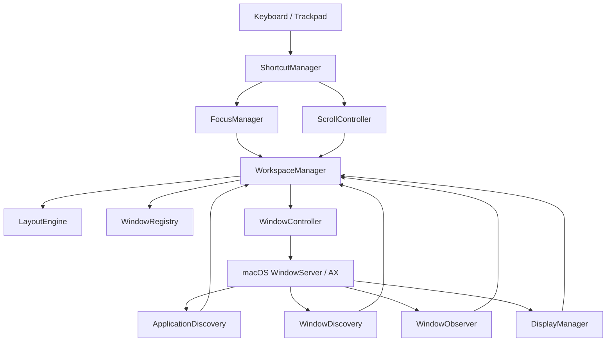

# Iume Architecture & Design Blueprint

## 1. System Overview

**Iume** brings the continuous, scrolling horizontal workspace model of Linux's **PaperWM** and **niri** to macOS. Rather than forcing all windows into a cramped, overlapping grid on a single fixed desktop, Iume organizes all application windows along an infinite horizontal strip of columns.

```
+----------------------------------------------------------------------------------------------------+
|                                    Infinite Horizontal Strip                                       |
|  +--------------+  +--------------------+  +----------------------+  +--------------------------+  |
|  |   Column 0   |  |      Column 1      |  |       Column 2       |  |         Column 3         |  |
|  |  (Terminal)  |  |    (VS Code)       |  |  (Safari / Browser)  |  |   (Notes / Slack)        |  |
|  +--------------+  +--------------------+  +----------------------+  +--------------------------+  |
|                             ^                                                                      |
|                +-------------------------+                                                         |
|                |  Visible Screen Camera  |                                                         |
|                |    (Viewport Offset)    |                                                         |
|                +-------------------------+                                                         |
+----------------------------------------------------------------------------------------------------+
```

---

## 2. Decoupled Modular Subsystems

The codebase is partitioned into distinct layers in `IumeCore` to ensure testability, safety, and separation of concerns:



### Subsystem Responsibilities

1. **`LayoutEngine`**: Pure deterministic calculation. Takes display geometry, column widths, window gap, and viewport offset, and produces exact `CGRect` target frames. Zero dependency on UI frameworks; 100% unit tested.
2. **`WindowRegistry`**: In-memory thread-safe store tracking `ManagedWindow` metadata, indexed by `WindowId` and `AXUIElement`.
3. **`ApplicationDiscovery` & `WindowDiscovery`**: Discovers eligible running GUI applications via `NSWorkspace`, queries accessible top-level windows, and filters out transient overlays, sheets, and system drawers.
4. **`WindowObserver`**: Subscribes to Accessibility notifications (`kAXWindowCreatedNotification`, `kAXUIElementDestroyedNotification`, `kAXWindowMovedNotification`, etc.) with debouncing and feedback loop suppression.
5. **`WindowController`**: Executes physical window repositioning (`kAXPositionAttribute`), sizing (`kAXSizeAttribute`), zooming, and focusing.
6. **`ScrollController`**: Manages horizontal viewport animation with cubic ease-out interpolation and snapping.
7. **`FocusManager`**: Directional navigation (`⌥ + H`, `⌥ + L`, `⌥ + J`, `⌥ + K`), window activation, and focus synchronization.
8. **`DisplayManager`**: Monitors physical display geometry, resolution changes, and multi-monitor hotplugging.
9. **`ShortcutManager`**: Carbon `RegisterEventHotKey` global dispatcher providing system-wide shortcut handling without requiring Input Monitoring permissions.
10. **`SettingsStore` & `SettingsUI`**: Native SwiftUI configuration interface backed by `UserDefaults`.
11. **`Diagnostics`**: Local, privacy-first structured logging and performance metrics.

---

## 3. Physical Window Positioning Model

Because macOS does not expose a programmable compositor pipeline to third-party applications, Iume implements the **Physical Desktop Coordinate Translation** architecture:

1. Each column $i$ is assigned a strip coordinate:
   $$\text{StripX}_0 = 0$$
   $$\text{StripX}_i = \text{StripX}_{i-1} + \text{Width}_{i-1} + \text{Gap}$$

2. The active physical screen position for window $w$ in column $i$ is:
   $$\text{ScreenX}_{w} = \text{VisibleFrame.origin.x} + \text{StripX}_i - \text{ViewportOffset}$$

3. When the viewport scrolls, `ScrollController` smoothly interpolates `ViewportOffset` from its current value to the target value. At each step, all managed windows are translated accordingly. Windows outside the screen rest off-screen in desktop coordinates space.

---

## 4. Loop Prevention & Cycle Elimination

A common flaw in window managers is the Accessibility notification loop:
1. Iume moves window A to `x = 200`.
2. macOS emits `kAXWindowMovedNotification`.
3. An unmitigated window manager interprets this as a user manual drag and recalculates the layout.
4. The recalculation triggers another move, causing severe CPU spikes and jitter.

**Iume's Solution:**
- `isPerformingProgrammaticUpdate` flag: During any layout or scroll translation, the observer ignores move/resize events.
- Debounced reconciliation: External user drags are debounced with a 150ms trailing window, preventing layout oscillations.
