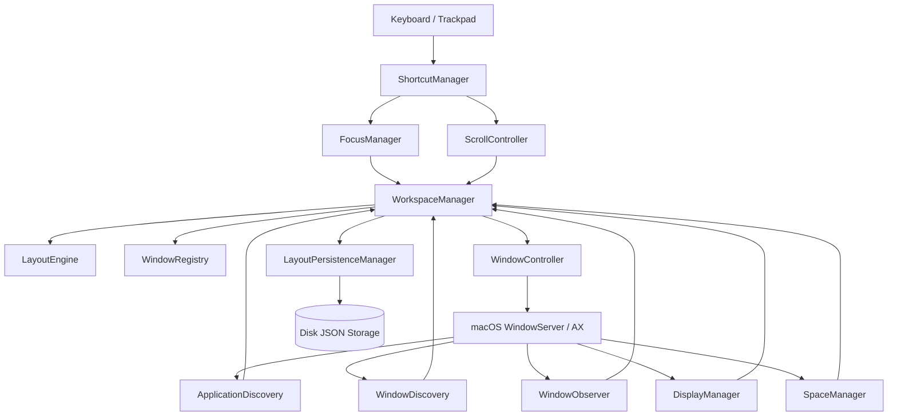

# Iume Architecture & Design Blueprint

## 1. System Overview

**Iume** brings the continuous, scrolling horizontal workspace model of Linux's **PaperWM** and **niri** to macOS. Rather than forcing all windows into a cramped, overlapping grid on a single fixed desktop, Iume organizes all application windows along an infinite horizontal strip of columns.

```
+----------------------------------------------------------------------------------------------------+
|                                    Infinite Horizontal Strip                                       |
|  +--------------+  +--------------------+  +----------------------+  +--------------------------+  |
|  |   Column 0   |  |      Column 1      |  |       Column 2       |  |         Column 3         |  |
|  |  (Terminal)  |  |    (VS Code)       |  |  (Safari / Browser)  |  |   (Notes / Slack)        |  |
|  +--------------+  +--------------------+  +----------------------+  +--------------------------+  |
|                             ^                                                                      |
|                +-------------------------+                                                         |
|                |  Visible Screen Camera  |                                                         |
|                |    (Viewport Offset)    |                                                         |
|                +-------------------------+                                                         |
+----------------------------------------------------------------------------------------------------+
```

---

## 2. Decoupled Modular Subsystems

The codebase is partitioned into distinct layers in `IumeCore` to ensure testability, safety, and separation of concerns:



### Subsystem Responsibilities

1. **`LayoutEngine`**: Pure deterministic calculation. Takes display geometry, column widths, window gap, and viewport offset, and produces exact `CGRect` target frames. Zero dependency on UI frameworks; 100% unit tested.
2. **`WindowRegistry`**: In-memory thread-safe store tracking `ManagedWindow` metadata, indexed by `WindowId` and `AXUIElement`.
3. **`ApplicationDiscovery` & `WindowDiscovery`**: Discovers eligible running GUI applications via `NSWorkspace`, queries accessible top-level windows, and filters out transient overlays, sheets, and system drawers.
4. **`WindowObserver`**: Subscribes to Accessibility notifications (`kAXWindowCreatedNotification`, `kAXUIElementDestroyedNotification`, `kAXWindowMovedNotification`, etc.) with debouncing and feedback loop suppression.
5. **`WindowController`**: Executes physical window repositioning (`kAXPositionAttribute`), sizing (`kAXSizeAttribute`), zooming, and focusing.
6. **`ScrollController`**: Manages horizontal viewport animation with physical damped harmonic oscillator spring physics, starting synchronously on keypress for zero perceived latency.
7. **`FocusManager`**: Directional navigation (`⌥ + H`, `⌥ + L`, `⌥ + J`, `⌥ + K`), window activation, and focus synchronization.
8. **`DisplayManager`**: Monitors physical display geometry, resolution changes, and multi-monitor hotplugging.
9. **`SpaceManager`**: Tracks macOS Mission Control virtual spaces per display, ensuring work and chat never get shuffled together.
10. **`LayoutPersistenceManager`**: Atomically serializes strip layout state to disk and restores column order, widths, and stacks across restarts.
11. **`ShortcutManager`**: Carbon `RegisterEventHotKey` global dispatcher providing system-wide shortcut handling without requiring Input Monitoring permissions.
12. **`SettingsStore` & `SettingsUI`**: Native SwiftUI configuration interface backed by `UserDefaults`.
13. **`Diagnostics`**: Local, privacy-first structured logging and performance metrics.

---

## 3. Physical Window Positioning Model

Because macOS does not expose a programmable compositor pipeline to third-party applications, Iume implements the **Physical Desktop Coordinate Translation** architecture:

1. Each column $i$ is assigned a strip coordinate:
   $$\text{StripX}_0 = 0$$
   $$\text{StripX}_i = \text{StripX}_{i-1} + \text{Width}_{i-1} + \text{Gap}$$

2. The active physical screen position for window $w$ in column $i$ is:
   $$\text{ScreenX}_{w} = \text{VisibleFrame.origin.x} + \text{StripX}_i - \text{ViewportOffset}$$

3. When the viewport scrolls, `ScrollController` smoothly interpolates `ViewportOffset` from its current value to the target value. At each step, all managed windows are translated accordingly. Windows outside the screen rest off-screen in desktop coordinates space.

---

## 4. Loop Prevention & Cycle Elimination

A common flaw in window managers is the Accessibility notification loop:
1. Iume moves window A to `x = 200`.
2. macOS emits `kAXWindowMovedNotification`.
3. An unmitigated window manager interprets this as a user manual drag and recalculates the layout.
4. The recalculation triggers another move, causing severe CPU spikes and jitter.

**Iume's Solution:**
- `isPerformingProgrammaticUpdate` flag & `recordExpectedFrame`: During programmatic layout passes, expected window frames are registered so programmatic move echoes are distinguished from user-driven interactions.
- Live Rate-Limited Edge Reconciliation (~40-50 FPS): Replaced trailing lag with throttled live event tracking. When a user resizes a window edge, the adjacent window automatically adjusts to the new boundary in real time without visual lag or window overlap.
- Zero-Overlap Geometry & Safe Offscreen Parking: Windows past `maxVisibleX` are deterministically parked offscreen in negative-X coordinates (`minVisibleX - colWidth - 200`), permanently preventing macOS WindowServer from edge-clamping windows back onto visible desktop columns.
- Focused-Strip Slotting: Newly launched apps and windows deterministically slot right next to the active focused column (`effectiveFocusedIndex + 1`), smoothly gliding into view beside the user's active task.

---

## 5. Reverse-Engineered 2-Finger Endless Scrolling Architecture

*(Primary motivation and mechanics derived from reverse engineering TileMyMac, ChainYourMac, and the Paneru engine)*

### 5.1 The 2-Finger Gesture Interception Pipeline
On macOS, trackpad gestures arrive through CoreGraphics as continuous `scrollWheel` events (`CGEventType.scrollWheel`). Rather than requiring awkward modifier keys, Iume uses **Smart Horizontal Intent Detection**:

1. **Horizontal vs Vertical Intent**:
   $$\text{IsHorizontal} = |dx| > |dy| \quad \text{and} \quad |dx| > 0.05$$
   - **Horizontal Swipes**: When horizontal intent dominates, `ScrollController` intercepts the event, consumes it (`return nil`), and directly glides the infinite horizontal strip.
   - **Vertical Swipes**: When vertical intent dominates ($|dy| \ge |dx|$), the event is passed through untouched (`return Unmanaged.passUnretained(event)`), allowing browsers (Safari, Chrome) and code editors (VS Code, Xcode) to scroll internal document pages without interference.

2. **Rolling Velocity & Momentum Physics**:
   $$\Delta t = \max(0.005, t_{\text{current}} - t_{\text{previous}})$$
   $$v_{\text{instant}} = \frac{\Delta x_{\text{effective}}}{\Delta t}$$
   $$v_{\text{rolling}} = 0.70 \cdot v_{\text{rolling}} + 0.30 \cdot v_{\text{instant}}$$

3. **Elastic Edge Rubber-Banding**:
   When the user scrolls past the boundaries of the strip ($x < 0$ or $x > \text{MaxOffset}$), elastic resistance dampens the offset:
   $$R = \max\left(0.12, 1.0 - \frac{\text{Overshoot}}{180}\right)$$
   Upon finger lift, the strip springs back smoothly to the boundary using a cubic ease-out curve.

4. **130ms Settle & Column Snapping**:
   When trackpad momentum ends or scrolling halts for 130ms:
   $$\text{TargetProjection} = \text{CurrentOffset} + v_{\text{rolling}} \cdot 0.18$$
   `LayoutEngine.findClosestColumnIndex` projects the ideal stopping column, triggers a spring transition to that column, and synchronously sets keyboard focus on the newly centered window.

5. **Zero-Blocking 120Hz ProMotion Engine & Asynchronous Window Writers**:
   In conventional window managers, moving windows during scroll invokes synchronous Accessibility APIs directly on the main thread. When multiple apps are on screen, each Mach IPC roundtrip can block the runloop for 10–100ms, starving the 8.33ms (120Hz) frame budget.
   Iume routes all window position writes during motion (`isMoving == true`) through dedicated per-PID background queues (`com.iume.ax.<pid>`):
   - **Latest-Wins Coalescing**: Intermediate coordinates are atomically overwritten if an application's queue is busy, dropping stale positions and applying only the most recent visual target.
   - **40ms Mach Messaging Timeout**: Responsive timeouts prevent unresponsive or hung applications from degrading strip scroll performance.
   - **AXEnhancedUserInterface Disabling**: Automatically sets `AXEnhancedUserInterface = false` per application to disable macOS internal move animations and heavy synchronous tree walks during continuous scrolling.
   - **In-Memory Frame Caching**: Bypasses IPC entirely if a window's origin shifted by $< 0.5\,\text{pt}$, and parks offscreen windows once rather than issuing redundant position updates.

6. **Continuous Exponential Smoothing & Jitter Elimination**:
   Trackpad touch sensors poll asynchronously at ~90–125Hz while macOS displays refresh at 60Hz or 120Hz. Raw delta dumping creates beat-frequency interference, resulting in alternating 0-delta (frozen) and double-delta (jumping) frames.
   Iume applies a frame-rate independent exponential smoothing filter on `CADisplayLink` hardware ticks:
   $$\text{factor} = 1.0 - \exp(-\lambda \cdot \Delta t) \quad \text{where} \quad \lambda = \max(20.0, 30.0 + (1.0 - \text{smoothness}) \cdot 70.0)$$
   $$\text{CurrentOffset}_{t} = \text{CurrentOffset}_{t-1} + (\text{SmoothTargetOffset} - \text{CurrentOffset}_{t-1}) \cdot \text{factor}$$
   This ensures buttery 120 FPS continuous motion across every display tick, even on frames where no trackpad hardware packet arrived.

7. **$C^1$ Velocity Continuity & Seamless Momentum Snap**:
   When the user's fingers lift from the trackpad or momentum ends:
   - The strip projects the resting column using $\text{smoothTargetOffset} + v_{\text{current}} \cdot 0.18$.
   - Rather than dropping velocity to zero (which causes a visible hitch), `settleVelocity` passes the true physical velocity directly into the analytical harmonic spring solver:
     $$\text{Position}_0 = \text{CurrentOffset}, \quad \text{Velocity}_0 = v_{\text{settle}}, \quad \text{Target} = \text{ColumnTarget}$$
   - Because position and velocity are continuous ($C^1$), the strip transitions from free gesture momentum to the column snap with zero visual hesitation.
   - Gesture ownership remains latched to `.strip` throughout both dragging and the macOS momentum stream, preventing events from leaking into background applications.

8. **System SPI & WindowServer IPC Elimination**:
   - `CGWindowID` lookups are cached in `WindowRegistry` (`getCGWindowID`), eliminating up to 1,200 `_AXUIElementGetWindow` SPI calls per second.
   - `NSScreen` instances are cached per display ID in `WorkspaceManager` (`cachedScreen(for:)`), eliminating expensive `NSScreen.screens` WindowServer queries during scrolling.
   - Minimap HUD and tab bar overlay re-renders are strictly throttled, avoiding continuous SwiftUI `NSHostingView` allocations.

---

## 6. HUD & Visual Enhancements

- **Floating Strip Minimap HUD (`MinimapHUDController`)**: A translucent glassmorphic capsule (`NSPanel` on `.floating` level) rendered at the bottom center of the active screen. Shows miniature proportional column pills, highlights the active column, and displays a gliding viewport frame tracking the user's position along the infinite strip. Automatically fades in on scroll and fades out after 1.25s of inactivity.
- **Focus Border Overlay (`FocusBorderOverlay`)**: A lightweight click-through accent border framing the currently active window on the strip, animated smoothly with `NSAnimationContext.runAnimationGroup` (ease-out curve, 0.22s duration) whenever focus shifts between columns.
- **Shortcut Presets**:
  - `⌃⌥ + R` / `⌥ + R`: Cycle Column Width ($33\% \rightarrow 50\% \rightarrow 66\% \rightarrow 75\% \rightarrow 100\%$)
  - `⌃⌥ + C` / `⌥ + C`: Center Active Column on Display
  - `⌃⌥ + F` / `⌥ + Return`: Maximize to Full Width
  - `⌃⌥ + ← / →` / `⌥ + H / L`: Directional Focus Navigation
  - `⌃⌥ + G`: Toggle Apps Edge Together (Zero Gap Mode)

---

## 7. Apps Edge Together & Magnetic Edge Snapping

### Zero-Gap Strip Tiling (`appsEdgeTogether`)
When `appsEdgeTogether` is enabled:
- The strip gap is set to $0.0\,\text{pt}$, tiling adjacent column strips flush against each other without revealing wallpaper:
  $$\text{colScreenX}_{i+1} = \text{colScreenX}_i + \text{colWidth}_i$$
- When toggled off, the previous user gap preference is seamlessly restored.
- Toggling can be done instantly via menu bar item (`🧲 Apps Edge Together (Zero Gap)`), Launch HUD quick controls, Settings View, or keyboard shortcut `⌃⌥G`.

### Precise Edge Reconciliation & Magnetic Snapping
- **Left-Edge Dragging Geometry**: The neighbor column origin remains anchored at its initial screen position:
  $$\text{prevColOriginX} = \text{expectedColScreenX} - \text{gap} - \text{width}_{i-1}$$
  $$\text{targetPrevWidth} = (\text{newFrame.minX} - \text{gap}) - \text{prevColOriginX}$$
  $$\text{colWidth}_i = \text{combined} - \text{targetPrevWidth}$$
- **Magnetic Snapping & Adhesion (`MagneticWindowEngine`)**:
  - **Adjacent Window Adhesion**: When two adjacent windows are open, dragging one window moves its adjacent companion in real time, keeping them magnetically attached without separation or gaps.
  - **Distance-Based Snap**: When separated windows are brought closer, once the distance drops below $32\,\text{pt}$, they snap together automatically like magnets.
  - **Seam Ratio Snapping**: During manual resizing, column ratios snap to common proportional splits ($25\%$, $33.3\%$, $50\%$, $66.7\%$, $75\%$) within an $18\,\text{pt}$ magnetic snap radius.
- **Asynchronous AX Element Updates & Anti-Flicker Architecture**:
  - Neighbor repositioning uses `controller.setPositionAsync` and `controller.setFrameAsync` on dedicated per-PID serial queues with latest-wins atomic drain loops.
  - Programmatic moves record expected frames in `WindowObserver` ($0.65\,\text{s}$ duration) to suppress echo loops.
  - Active drag lockout (`activelyDraggingWindowId`) drops secondary notifications at the gate.
  - Global mouse-up event monitoring triggers a silky $120\,\text{Hz}$ harmonic spring settle pass on finger lift, guaranteeing zero visual flicker.
