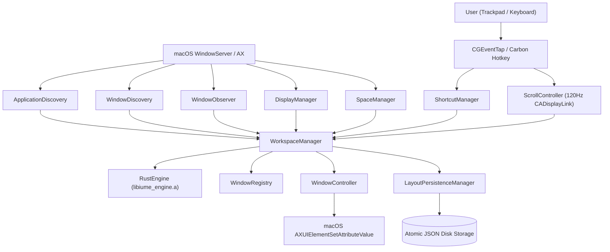

# Iume: Complete Reverse-Engineering Technical Specification & Architecture Knowledge Base

> **Confidentiality & Integrity Notice**: This document is the definitive master reverse-engineering specification for **Iume** (Native macOS Scrolling Window Manager). It contains full architectural blueprints, mathematical derivations, component interactions, C ABI declarations, and step-by-step reproduction instructions.
>
> **Verified Baseline**: 151 files, 67,846 lines of code, tests, documentation, and tooling. 413/413 deterministic audit tests passing.

---

## Table of Contents

1. [System Overview & Operating Model](#1-system-overview--operating-model)
2. [Complete Codebase File Inventory](#2-complete-codebase-file-inventory)
3. [End-to-End System Architecture](#3-end-to-end-system-architecture)
4. [Rust Engine & Static C ABI Bridge](#4-rust-engine--static-c-abi-bridge)
5. [macOS Accessibility & Window Pipeline](#5-macos-accessibility--window-pipeline)
6. [Scrolling Physics & Motion Resampling](#6-scrolling-physics--motion-resampling)
7. [Layout Engines, Tabs & Magnetic Snapping](#7-layout-engines-tabs--magnetic-snapping)
8. [User Interfaces, Minimaps & Sound Engine](#8-user-interfaces-minimaps--sound-engine)
9. [Cryptographic Security & Scroll Lock](#9-cryptographic-security--scroll-lock)
10. [Reproduction, Compilation & Deployment](#10-reproduction-compilation--deployment)
11. [Configuration & Keyboard Shortcuts](#11-configuration--keyboard-shortcuts)
12. [Troubleshooting & Maintenance Runbook](#12-troubleshooting--maintenance-runbook)
13. [Verified Invariants vs Roadmap](#13-verified-invariants-vs-roadmap)

---

## 1. System Overview & Operating Model

### 1.1 The Linear Desktop Paradigm
Traditional macOS window management forces applications into overlapping floating rectangles on a fixed, finite desktop. Even tiling window managers (Yabai, Amethyst, Rectangle) partition a single display into smaller, increasingly cramped boxes.

**Iume** ports and refines the continuous workspace model of Linux's **PaperWM** and **niri**:
- Applications are organized along an **unbounded, infinite horizontal strip** of columns.
- Rather than resizing windows smaller as more apps open, columns retain their optimal width (50%, 66.7%, 75%, 100%).
- The monitor acts as a sliding camera aperture gliding horizontally over the strip with 120Hz physical spring physics.

```
+----------------------------------------------------------------------------------------------------+
|                                    Infinite Horizontal Strip                                       |
|  +--------------+  +--------------------+  +----------------------+  +--------------------------+  |
|  |   Column 0   |  |      Column 1      |  |       Column 2       |  |         Column 3         |  |
|  |  (Terminal)  |  |    (VS Code)       |  |  (Safari / Browser)  |  |   (Notes / Slack)        |  |
|  +--------------+  +--------------------+  +----------------------+  +--------------------------+  |
|                             ^                                                                      |
|                +-------------------------+                                                         |
|                |  Visible Screen Camera  |                                                         |
|                |    (Viewport Offset)    |                                                         |
|                +-------------------------+                                                         |
+----------------------------------------------------------------------------------------------------+
```

### 1.2 Coordinate System Translation
Because macOS does not expose compositor pipelines to user-space apps, Iume translates linear strip space into desktop space via Accessibility C-APIs:
$$\text{StripX}_0 = 0, \quad \text{StripX}_i = \text{StripX}_{i-1} + \text{Width}_{i-1} + \text{Gap}$$
$$X_{\text{screen}} = \text{VisibleFrame.origin.x} + \text{StripX}_i - \text{ViewportOffset}$$

---

## 2. Complete Codebase File Inventory

The Iume repository consists of **151 files and 67,846 lines** organized into distinct layers:

### Primary Subsystems Summary:
- **`crates/iume_engine/` (2,559 lines)**: Pure Rust deterministic static library providing allocation-free layout, spring, and magnetic math.
- **`Sources/CIumeEngine/` (196 lines)**: C ABI bridge declaring stable `#[repr(C)]` signatures.
- **`Sources/IumeCore/` (24,115 lines)**: Swift framework housing window controllers, motion integrators, workspace managers, HUDs, and SwiftUI settings.
- **`Sources/Iume/` (98 lines)**: Executable entry point with single-instance lock and signal handlers.
- **`Tests/IumeCoreTests/` (14,482 lines)**: 21 comprehensive XCTest test suites.
- **`scripts/audit/` (11,840 lines)**: Deterministic 4-suite test gate and benchmark harnesses.
- **`tools/scroll_lock.py` (370 lines)**: SHA-256 and PBKDF2 password protection guard.

*(Detailed file-by-file breakdown is documented in [Module 01: Executive Summary & Complete Codebase Inventory](file:///Users/bves/projects/Iume/docs/manual/01_EXECUTIVE_SUMMARY_AND_COMPLETE_FILE_INVENTORY.md)).*

---

## 3. End-to-End System Architecture



### Key Architectural Tenets:
1. **Unidirectional Event Flow**: User inputs stimulate `ScrollController` or `ShortcutManager`, which updates `WorkspaceManager`. `WorkspaceManager` queries `RustEngine` and dispatches `CGRect` frames to `WindowController`.
2. **Per-PID Queue Isolation**: Window position writes are isolated on serial queues (`AppAXContext`) per target PID, preventing slow applications from freezing the system.
3. **Echo Suppression**: Accessibility window-moved notifications matching in-flight generations are suppressed, eliminating CPU feedback storms.

*(Refer to [Module 02: Architecture, Subsystems & Data Flows](file:///Users/bves/projects/Iume/docs/manual/02_ARCHITECTURE_SUBSYSTEMS_AND_DATA_FLOWS.md) for sequence diagrams and concurrency blueprints).*

---

## 4. Rust Engine & Static C ABI Bridge

### 4.1 Memory Architecture (`#[repr(C)]`)
The Rust engine operates completely on caller-owned or thread-local static buffers. It performs **zero heap allocations** on the 120Hz layout tick.

```rust
pub const MAX_FRAMES: usize = 256;

#[repr(C)]
pub struct FrameBuffer {
    pub frames: [FrameOut; MAX_FRAMES],
    pub count: usize,
    pub total_strip_width: f64,
    pub target_viewport_offset: f64,
}
```

### 4.2 Damped Harmonic Oscillator Math
Window and viewport motion is modeled analytically:
$$\frac{d^2x}{dt^2} + 2\zeta\omega \frac{dx}{dt} + \omega^2 (x - x_{\text{target}}) = 0$$

- **Underdamped ($\zeta < 1$)**:
  $$d(t) = e^{-\zeta\omega t} \left[ d_0 \cos(\omega_d t) + \left(\frac{v_0 + \zeta\omega d_0}{\omega_d}\right) \sin(\omega_d t) \right]$$
- **Critically Damped ($\zeta = 1$)**:
  $$d(t) = e^{-\omega t} [d_0 + (v_0 + \omega d_0) t]$$
- **Overdamped ($\zeta > 1$)**:
  Two real exponential decay roots $r_1, r_2 = -\zeta\omega \pm \omega\sqrt{\zeta^2 - 1}$.

*(Refer to [Module 03: Rust Core Engine & C ABI Bridge](file:///Users/bves/projects/Iume/docs/manual/03_RUST_CORE_ENGINE_AND_C_ABI_BRIDGE.md) for FFI declarations and staticlib linking).*

---

## 5. macOS Accessibility & Window Pipeline

### 5.1 Private SPI Bindings
Direct binding to internal Quartz APIs bypasses slow dictionary iteration:
- `_AXUIElementGetWindow`: Direct extraction of `CGWindowID`.
- `GetProcessForPID` with `kCPSUserGenerated`: Clean activation without focus-stealing warnings.

### 5.2 Window Placement Lifecycle
Every frame write transitions through:
$$\text{Desired} \longrightarrow \text{In-Flight} \longrightarrow \text{Verified} \longrightarrow \text{Echo Filtered}$$
- **Generation Ordering**: 64-bit monotonically increasing counter.
- **Latest-Wins Coalescing**: Drops intermediate 120Hz frames when the target application's serial queue is busy.
- **Bounded Retry Cap**: Caps failures at 3 attempts before quarantining unstable windows.

*(Refer to [Module 04: Window Management, Accessibility & AX Pipeline](file:///Users/bves/projects/Iume/docs/manual/04_WINDOW_MANAGEMENT_ACCESSIBILITY_AND_AX_PIPELINE.md) for full state machine logic).*

---

## 6. Scrolling Physics & Motion Resampling

### 6.1 Direct Touch vs Continuous Smoothing
- **Direct Touch (Phases 1 & 2)**: 1:1 instantaneous response. Zero filter delay while fingers remain on glass.
- **Smoothing Filter**: Low-pass filter $1.0 - e^{-\lambda \cdot dt}$ smoothing discrete wheel ticks and bursty trackpad packets.

### 6.2 The 4 Kinetic Profiles
1. **`.natural`**: Frame-rate independent closed-form exponential decay ($v = v_0 k^t, \Delta x = v_0 \frac{k^t - 1}{\ln k}$).
2. **`.viscous`**: Quadratic aerodynamic drag ($\frac{dv}{dt} = -(\alpha v + \beta v |v|)$), arresting fast flicks smoothly.
3. **`.highInertia`**: Extended momentum glide for wide multi-monitor strips.
4. **`.snappy`**: High friction with aggressive linear arrest below $250\text{ pt/s}$.

*(Refer to [Module 05: Scrolling Physics & Trackpad Interaction](file:///Users/bves/projects/Iume/docs/manual/05_SCROLLING_PHYSICS_AND_TRACKPAD_INTERACTION.md) for detailed formulas).*

---

## 7. Layout Engines, Tabs & Magnetic Snapping

### 7.1 Layout Modes
- **Scroll Strip**: Standard PaperWM/niri infinite horizontal strip.
- **Focus Column / Centered Focus**: Keeps the active window locked to screen center.
- **Loop Mode (Circular Strip)**: Endless wrapping with acoustic wooden tick on seam cross.
- **Box Tiling**: Multi-window adaptive grid (Grid, Tall, Wide, BSP).

### 7.2 Stacking & Tabbed Columns
- **Stacking**: Proportional vertical partitions within a single column.
- **Tabbed Presentation**: 100% height tabs with sleek dark overlay tab bar and animated slide/crossfade transitions.
- **Native Tab Grouping**: Transparently groups Safari, Finder, and Ghostty native tabs.

### 7.3 Magnetic Adhesion
- 32pt proximity attraction radius.
- Seam ratio quantization ($\frac{1}{4}, \frac{1}{3}, \frac{1}{2}, \frac{2}{3}, \frac{3}{4}$).
- Neighbor-aware edge push/pull with zero overlap.

*(Refer to [Module 06: Layout Modes, Tab Grouping & Magnetic Snapping](file:///Users/bves/projects/Iume/docs/manual/06_LAYOUT_MODES_TAB_GROUPING_AND_MAGNETIC_SNAPPING.md) for layout mechanics).*

---

## 8. User Interfaces, Minimaps & Sound Engine

### 8.1 Floating HUD Instruments
- **Launch HUD**: Central dashboard with primary Kickstart action, Arrangement status, live physics sliders, and column presets.
- **Minimap HUD**: 7 selectable instruments (Circular Dial, Linear Strip, Loop Carousel 3D, Horizon Ellipse radar, Ticker Tape, Spectrum, Timeline).
- **Settings View**: 8-tab native SwiftUI preferences suite.
- **Procedural Audio**: Low-latency CoreAudio synthesis of loop ticks, magnetic snaps, and tab haptics.

*(Refer to [Module 07: User Interfaces, HUDs & Settings System](file:///Users/bves/projects/Iume/docs/manual/07_USER_INTERFACES_HUDS_AND_SETTINGS_SYSTEM.md) for UI architecture).*

---

## 9. Cryptographic Security & Scroll Lock

To safeguard the verified perfect scrolling physics, **11 code sections across 7 files** are locked:

- **Password Verification**: PBKDF2-HMAC-SHA256 with 200,000 rounds and 128-bit salt in [`.scroll_lock.json`](file:///Users/bves/projects/Iume/.scroll_lock.json).
- **Integrity Validation**: SHA-256 section hashes checked before every git commit via [`.git/hooks/pre-commit`](file:///Users/bves/projects/Iume/.git/hooks/pre-commit).
- **Time-Limited Token**: Valid password issues a 15-minute `.scroll_lock.token`.
- **Contributor Governance**: [`.agentrules`](file:///Users/bves/projects/Iume/.agentrules) forbids modifications without explicit user password authorization.

*(Refer to [Module 08: Security, Integrity Lock & Permissions](file:///Users/bves/projects/Iume/docs/manual/08_SECURITY_INTEGRITY_LOCK_AND_PERMISSIONS.md) for full security specs).*

---

## 10. Reproduction, Compilation & Deployment

### Quick Reproduction Recipe
```bash
# 1. Compile Rust Static Engine
bash scripts/build-rust.sh

# 2. Build Debug or Release Swift Package
bash scripts/build.sh          # Debug
bash scripts/build-release.sh  # Release

# 3. Run Deterministic Test Suite Gate (413/413 Checks)
bash scripts/audit/run-all-tests.sh

# 4. Package, Sign, and Install
bash scripts/package.sh
```

*(Refer to [Module 09: Build, Deployment, Reproduction & Testing](file:///Users/bves/projects/Iume/docs/manual/09_BUILD_DEPLOYMENT_REPRODUCTION_AND_TESTING.md) for certificate creation and packaging details).*

---

## 11. Configuration & Keyboard Shortcuts

- **Global Hotkeys**: Full navigation with `⌥H/J/K/L`, column swaps with `⌥⇧H/L`, width cycling with `⌥R`, full width with `⌥F`.
- **Remappable Bindings**: Full live recorder in **Settings > Shortcuts**; floating cheatsheet on `⌃⌥/`.
- **Durable Persistence**: `UserDefaults` mirrored to atomic JSON snapshots in `~/Library/Application Support/Iume/`.

*(Refer to [Module 10: Configuration, Shortcuts, Troubleshooting & Roadmap](file:///Users/bves/projects/Iume/docs/manual/10_CONFIGURATION_SHORTCUTS_TROUBLESHOOTING_AND_ROADMAP.md) for complete shortcut tables).*

---

## 12. Troubleshooting & Maintenance Runbook

1. **Terminal.app Screen Edge Gaps**:
   - `EnableSmoothResizing = 1` is configured in `com.apple.Terminal.plist`.
   - Quit Terminal (`Cmd + Q`) and reopen to activate smooth continuous resizing.
2. **Stale TCC Permissions**:
   - Reset via `tccutil reset Accessibility com.iume.app` and sign with `Iume Local Signer`.
3. **Orphaned Lock File**:
   - Remove `/tmp/com.iume.app.lock` if process terminated unexpectedly.

---

## 13. Verified Invariants vs Roadmap

### 13.1 Verified Invariants (100% Proven Green)
- **Layout Suite**: 95 checks passed.
- **Physics Suite**: 238 adversarial checks passed (zero displacement drift over 10,000 fuzzing steps).
- **Window AX Suite**: 44 checks passed (isolated slow PID queues verified).
- **Rust Parity Suite**: 36 unittests passed.

### 13.2 Roadmap & Future Upgrades
- Frame undo / history stack (`⌃⌥⌫`).
- Named workspace profiles (`Work`, `Code`, `Comms`).
- Apple Shortcuts URL scheme actions (`iume://layout/strip`).
