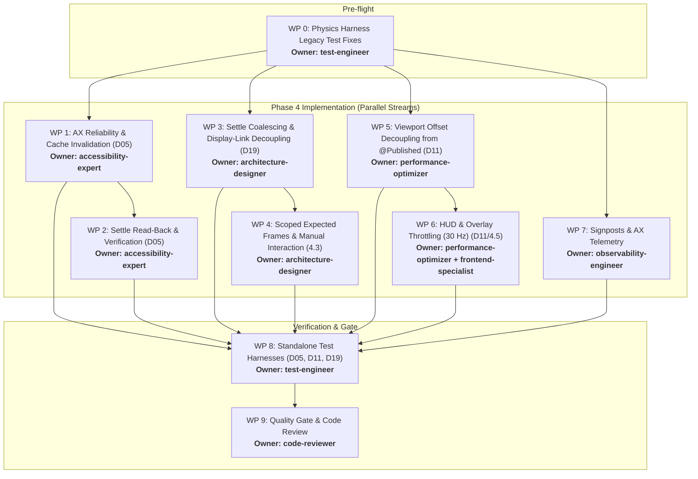

# 09 — Phase 4 Triage: Window Application Pipeline, Accessibility Reliability & Rendering Overhead

**Document Date:** October 26, 2026  
**Status:** Triage Complete — Ready for Subagent Dispatch  
**Target:** Iume Core Window Application Pipeline, Accessibility Reliability, and UI Rendering Overhead  
**Working Directory:** `/Users/bves/projects/Iume`

---

## 1. Executive Summary & Review of Phases 2 and 3

### 1.1 What Phase 2 Delivered
Phase 2 targeted mathematical correctness and single source of truth across the motion and layout pipelines:
- **D01 (Spring completion clamp):** Implemented re-querying of `onQueryMaxOffset` and post-settle destination clamping in `finishSpring()` (`ScrollController.swift:662-688`).
- **D02 (Settle velocity zeroing):** Re-zeroed spring position, target, and velocity across all settle exit paths (`ScrollController.swift:1152-1217`).
- **D09 (Timer phase-guards):** Settler and momentum watchdog timers were guarded with `gestureGeneration` counters and phase assertions.
- **D13 (Frame-rate-independent spring):** Introduced analytic closed-form spring solver in `Sources/IumeCore/Physics/SpringState.swift`.
- **D16 & D18 (Scroll bounds authority):** Established `refreshScrollBounds(for:)` in `WorkspaceManager.swift`, providing a single authoritative calculation of `maxOffset`, `usableWidth`, and `loopEligible` across scrolling, snapping, keyboard, and scrub paths (validated with 71 passing checks in `layout-harness`).
- **D21 (Dead code removal):** Completely removed unused `CriticallyDampedSpring`.

### 1.2 What Phase 3 Delivered
Phase 3 resolved trackpad gesture direct manipulation without degrading to unresampled packet aliasing:
- **D04 (Direct-touch resampling):** Implemented `DirectTouchResampler` inside `ScrollController.swift`, utilizing a bounded input reservoir drained over the observed input cadence (2–8 display ticks). Achieved **0 frozen frames** at 60/80/120 Hz and **≤ 8.47 ms** average latency without artificial exponential lag (documented in `08-phase3-direct-touch.md`).
- **D06 (Diagonal gesture hand-back):** Implemented `shouldHandBackDiagonal` / `handBackGestureToApp` behind the `iume.diagonalHandback` user default (default off).

### 1.3 Baseline Status & Current Working Tree
- **Layout Suite:** 71 checks pass (`scripts/audit/run-layout-tests.sh` with `/tmp/swift-module-cache`).
- **Rust Engine Suite:** 36 unittests pass (`cargo test --release`).
- **Physics Harness:** 227 of 231 checks pass. 4 checks failed due to legacy assertions in `scripts/audit/harness/main.swift` expecting old unresampled 1:1 behavior (`testDirectManipulationZeroInputLag`, `testVelocityContinuityAcrossSettle`, and mid-gesture input gap boundary), as predicted in `06-test-matrix.md` §3. These must be updated as a Step 0 pre-flight.

---

## 2. Exact Status of D05, D11, and D19 in Current Codebase

### 2.1 D05 — Window Writer Intent Caching & Lack of Read-back
- **Status:** **Partially Addressed, Core Vulnerabilities Open**
- **Inspection Findings:**
  1. **Premature Cache Update:** In `WindowController.swift:608-615` (`setPositionAsync`), `lastAppliedFrames[windowId]` is updated on the main actor *before* the asynchronous write closure runs on the app's serial AX queue.
  2. **Discarded Error Codes:** In `WindowWriter.setPositionAsync` (`:104`) and `WindowWriter.writeFrame` (`:172, :175, :177`), the return value of `AXUIElementSetAttributeValue` (`AXError`) is completely ignored (`_ = AXUIElementSetAttributeValue(...)`).
  3. **No Invalidation on Failure:** If an AX write fails (`.cannotComplete`, `.notImplemented`, or timeout), `lastAppliedFrames` remains set to the requested coordinate. On future frames, `abs(prev.origin.x - rounded.x) < 0.5` evaluates to true, dropping updates and leaving the physical window desynchronized until settle.
  4. **Settle Verification Implementation:** `WindowWriter.verifyAndRepair` (`:181-194`) exists and checks actual AX position/size with a 1.0 pt tolerance, retrying once. However, if the retry fails, `lastAppliedFrames` is not updated or invalidated, and there is no consecutive failure tracking or telemetry.
  5. **Parked Windows Unverified:** In `WindowController.applyStripFrames(isMoving: false)` (`:427-453`), parked offscreen windows are written via `setPositionAsync` and never verified.

### 2.2 D11 — Per-Frame `@Published` Mutation, Expected-Frame Churn & HUD Copy
- **Status:** **Fully Open (Unresolved)**
- **Inspection Findings:**
  1. **Per-Frame `@Published` Workspace Mutation:** In `WorkspaceManager.swift:728-734`:
     ```swift
     scrollController.onViewportOffsetChanged = { [weak self] newOffset in
         guard let self = self else { return }
         guard var ws = self.workspaces[self.activeDisplayId] else { return }
         ws.viewportOffset = newOffset
         self.workspaces[self.activeDisplayId] = ws // Mutates @Published workspaces dictionary every frame!
         self.applyPhysicalWindowPositions(workspace: ws)
     }
     ```
     `workspaces` is `@Published public internal(set) var workspaces: [CGDirectDisplayID: DisplayWorkspace]`. Mutating this property on every display-link tick fires Combine's `objectWillChange` and triggers SwiftUI re-evaluations across all observing controllers (e.g., `LaunchHUDController`, which declares `@ObservedObject var workspaceManager = WorkspaceManager.shared`).
  2. **Unconditional `recordExpectedFrame` Churn:** In `WorkspaceManager.swift:3185`:
     Inside `applyPhysicalWindowPositions`, `observer.recordExpectedFrame(targetFrame, for: winId, duration: 0.65)` is invoked unconditionally for *every window in every column*, even if the window is stationary, parked, or suppressed from write issuance. This churns the 64-item `expectedFrames` dictionary 60–120 times per second.
  3. **Unthrottled HUD Column Mapping:** In `WorkspaceManager.swift:737-750`, `scrollController.onScrollActivity` runs per frame and passes `ws.columns` into `MinimapHUDController.shared.update`, which maps every column (`columns.map { DialColumnInfo(...) }`) and scans bundle identifiers before checking throttling timestamps.

### 2.3 D19 — Synchronous Window Application in Display-Link Tick
- **Status:** **Fully Open (Unresolved)**
- **Inspection Findings:**
  1. **Synchronous Settle Execution:** In `WorkspaceManager.swift:753-808`, `scrollController.onSettleRequested` is invoked synchronously inside `displayLinkFired`. Under `freezeOnRelease` or `!snapToColumn`, it calls `applyPhysicalWindowPositions(workspace: updatedWs)` immediately.
  2. **Snapping Re-entrancy:** If snapping is active and the target is within 0.5 pt, `scrollController.scrollTo` completes immediately and triggers `onAnimationCompleted`, resulting in a *second* full `applyPhysicalWindowPositions` within the exact same frame callback.
  3. **Display-Link Frame Budget Violation:** Running multiple full layout passes and AX window queue flushes inside the display-link callback introduces frame hitching.

---

## 3. Phase 4 Technical Requirements & Work Scope

1. **Accessibility Reliability & Bounded Retries:**
   - Capture `AXError` from every `AXUIElementSetAttributeValue`.
   - On non-`.success` return, immediately clear `lastAppliedFrames[windowId]` so future frames or settle retries re-attempt.
   - Implement per-window consecutive-failure counter (cap at 3) to prevent runaway retry storms on unresponsive applications.
   - Retain serial per-PID queues (`AppAXContext`) to guarantee slow apps never block the main thread or other apps.
2. **Settle Verification & Authoritative Alignment:**
   - Settle pass must bypass motion delta suppression and enforce authoritative placement.
   - Settle verification must read back `kAXPositionAttribute` and `kAXSizeAttribute` on the app's serial queue.
   - Correct discrepancies > 1.0 pt with a bounded single retry.
3. **Decoupled Viewport Offset & Zero Observable Churn:**
   - Extract `viewportOffset` from `@Published workspaces` into an unobserved or throttled (≤ 10 Hz) rendering state.
   - Ensure continuous scrolling produces **zero** unnecessary `objectWillChange` broadcasts from `WorkspaceManager`.
4. **Scoped Expected-Frame Registration:**
   - Call `observer.recordExpectedFrame` ONLY when a window write is actually dispatched to the AX pipeline.
5. **Decoupled Settle Application:**
   - Coalesce settle window application into `DispatchQueue.main.async` or the subsequent frame tick, eliminating synchronous multi-pass layout from `displayLinkFired`.
6. **Rendering Overhead & UI Throttling:**
   - Throttle `MinimapHUDController` data transformation to ≤ 30 Hz.
   - Ensure `FocusBorderOverlay`, `TabBarOverlayController`, and `DimmingOverlayController` produce 0 allocations or redundant updates during continuous motion.
7. **Diagnostics & Telemetry:**
   - Introduce `IumeSignpost` (`scroll.frame`, `workspace.apply`, `window.axWrite`, `window.settle`).
   - Log AX errors, timeouts, and repairs to the diagnostics ring buffer.
8. **Test Automation Without Xcode:**
   - Develop standalone `swiftc` harnesses exercising D05, D11, and D19 proving scenarios.

---

## 4. Minimal Subagent Set Selection

From the 25 specialist roles in the swarm, we select a minimal set of **6 specialists + 1 quality-gate** to eliminate overhead while covering all technical boundaries:

| Role | Subagent Specialist | Justification & Responsibility |
|---|---|---|
| 1 | **accessibility-expert** | macOS AX API mastery (`AXUIElement`, `AXValue`, `AXError`, `AppAXContext`), write error handling, retry bounding, and settle read-back repair (D05, 4.1, 4.2). |
| 2 | **architecture-designer** | Pipeline design, settle pass decoupling/coalescing (`onSettleRequested`), display-link tick hygiene, and observer coordination (D19, 4.3, 4.6). |
| 3 | **performance-optimizer** | Decoupling `viewportOffset` from `@Published workspaces`, eliminating per-frame allocations, and HUD update rate regulation (D11, 4.4, 4.5). |
| 4 | **frontend-specialist** | AppKit/SwiftUI overlays (`MinimapHUDController`, `FocusBorderOverlay`, `TabBarOverlayController`), frame pacing, and non-activating panel lifecycle. |
| 5 | **observability-engineer** | Signposts (`OSSignposter`), `OSLog` subsystem, AX write latency tracking, and error telemetry (D24, Phase 5 bridge). |
| 6 | **test-engineer** | Test harness development (`swiftc` CLI-compatible), proving tests for D05/D11/D19, and physics harness legacy cleanup. |
| 7 | **code-reviewer** (Quality Gate) | Strict independent review, regression checking, invariant validation, and commit readiness. |

*Excluded Specialists (Not needed for Phase 4):*
`researcher`, `security-auditor`, `docs-writer`, `refactorer` (absorbed by specialists), `bug-hunter` (absorbed by test/accessibility), `data-analyst`, `devops-engineer`, `backend-specialist`, `database-expert`, `api-designer`, `ml-ai-researcher`, `open-source-scout`, `dependency-manager`, `ci-cd-specialist`, `ux-reviewer`, `localization-expert`, `cost-optimizer`, `memory-curator`.

---

## 5. Work Packages, Tasks, and Deliverables



### WP 0: Baseline Stabilization (Owner: `test-engineer`)
- **Task 0.1:** Update `scripts/audit/harness/main.swift` legacy assertions for `testDirectManipulationZeroInputLag` and `testVelocityContinuityAcrossSettle` to reflect resampled direct touch.
- **Task 0.2:** Adjust mid-gesture gap catch-up threshold to account for discrete tick boundaries.
- **Deliverable:** `scripts/audit/run-physics-tests.sh` passes 100% (231/231 checks green).

### WP 1: AX Reliability & Cache Invalidation (Owner: `accessibility-expert`)
- **Task 1.1:** Modify `WindowWriter` to evaluate `AXUIElementSetAttributeValue` return status.
- **Task 1.2:** Introduce a failure reporting mechanism to `WindowController` that immediately clears `lastAppliedFrames[windowId]` on non-`.success` AX returns.
- **Task 1.3:** Implement a per-window consecutive-failure counter with a threshold of 3, logging warnings when exceeded.
- **Deliverable:** Modified `Sources/IumeCore/Controller/WindowController.swift` ensuring failed writes are never treated as applied.

### WP 2: Settle Verification & Repair (Owner: `accessibility-expert`)
- **Task 2.1:** Ensure `WindowController.applyStripFrames(isMoving: false)` executes unconditional writes and enforces settle verification for all visible windows.
- **Task 2.2:** Verify that parked offscreen windows during settle are correctly aligned without redundant IPC.
- **Task 2.3:** Ensure `WindowWriter.verifyAndRepair` updates `lastAppliedFrames` upon successful read-back repair and logs persistent mismatches.
- **Deliverable:** Production-grade settle verification in `WindowController.swift`.

### WP 3: Settle Coalescing & Display-Link Hygiene (Owner: `architecture-designer`)
- **Task 3.1:** Decouple `scrollController.onSettleRequested` and `onAnimationCompleted` from the immediate display-link callback.
- **Task 3.2:** Coalesce settle window application into `DispatchQueue.main.async` or the next display tick.
- **Task 3.3:** Ensure synchronous completion of `scrollTo` does not trigger re-entrant `applyPhysicalWindowPositions`.
- **Deliverable:** Settle execution decoupled from display-link ticks in `WorkspaceManager.swift`.

### WP 4: Scoped Expected-Frame Registration & Manual Moves (Owner: `architecture-designer`)
- **Task 4.1:** In `WorkspaceManager.applyPhysicalWindowPositions`, invoke `observer.recordExpectedFrame` **only** for windows where an AX write is issued.
- **Task 4.2:** Validate that manual mouse moves/resizes (`resizingWindowId`, `isPerformingProgrammaticUpdate`) operate without feedback oscillations.
- **Deliverable:** Reduced observer registration churn in `WorkspaceManager.swift`.

### WP 5: Viewport Offset Decoupling from `@Published Workspaces` (Owner: `performance-optimizer`)
- **Task 5.1:** Move high-frequency `viewportOffset` out of `@Published public internal(set) var workspaces`.
- **Task 5.2:** Maintain an internal active viewport offset for real-time layout computation.
- **Task 5.3:** Audit observers of `workspaces` (such as `LaunchHUDController`), ensuring they only observe structural changes, publishing viewport offset only at settle or throttled (≤ 10 Hz).
- **Deliverable:** Elimination of per-frame `@Published` emissions in `WorkspaceManager.swift`.

### WP 6: Minimap HUD & Overlay Throttling (Owner: `performance-optimizer` + `frontend-specialist`)
- **Task 6.1:** Add a 30 Hz time-guard in `WorkspaceManager.swift` before calling `MinimapHUDController.shared.update`, avoiding per-frame `columns.map` allocations.
- **Task 6.2:** Verify `FocusBorderOverlay` and `TabBarOverlayController` suppress frame updates during active scrolling.
- **Deliverable:** Reduced CPU/allocations during continuous scrolling.

### WP 7: AX Telemetry, Logging & Signposts (Owner: `observability-engineer`)
- **Task 7.1:** Create `Sources/IumeCore/Diagnostics/Signposts.swift` implementing `OSSignposter` intervals:
  - `scroll.frame`
  - `workspace.apply`
  - `window.setPositionAsync`
  - `window.setFrame`
  - `window.settle`
- **Task 7.2:** Emit signpost events for `window.axWrite` (with `AXError` and PID) and `window.axRepair`.
- **Task 7.3:** Forward critical AX timeouts and failure bursts to `Diagnostics.record`.
- **Deliverable:** `Sources/IumeCore/Diagnostics/Signposts.swift` and integrated telemetry.

### WP 8: Standalone Test Harnesses for D05, D11, D19 (Owner: `test-engineer`)
- **Task 8.1:** Build `scripts/audit/harness/window/main.swift` testing:
  - `failedWriteIsRetried`: Simulating `.cannotComplete`, checking cache invalidation and retry.
  - `settleVerificationRepairs`: Verifying mismatched coordinate detection and single-retry repair.
  - `noObservablePublishDuringMotion`: Asserting zero `@Published` emissions during 120-frame simulated scroll.
  - `settleAppliesOncePerFrame`: Verifying ≤ 1 layout application per tick during settle.
- **Task 8.2:** Add `scripts/audit/run-window-tests.sh` with standalone `swiftc` compilation.
- **Deliverable:** Executable test suite verifying Phase 4 fixes without Xcode.

### WP 9: Quality Gate Verification (Owner: `code-reviewer`)
- **Task 9.1:** Execute full validation suite: physics harness (231 checks), layout harness (71 checks), window harness, and Rust test suite (36 tests).
- **Task 9.2:** Verify zero regressions against untouched components (tiling, tab grouping, permissions).
- **Task 9.3:** Produce Phase 4 completion audit report.
- **Deliverable:** Quality Gate sign-off.

---

## 6. Execution Plan & Timeline

| Stage | Duration | Primary Tasks | Verification Gate |
|---|---|---|---|
| **Phase 0: Pre-flight** | 1 Hour | WP 0 (Fix physics harness legacy assertions) | `run-physics-tests.sh` = 231/231 PASS |
| **Phase 4A: Core Implementation** | 1 Day | WP 1, WP 2, WP 5, WP 6, WP 7 (AX reliability, state decoupling, HUD throttling, signposts) | Unit compilation via `swiftc` CLI |
| **Phase 4B: Pipeline Integration** | 0.5 Day | WP 3, WP 4 (Settle coalescing, scoped expected frames) | Architecture review & compilation |
| **Phase 4C: Test Harness Verification** | 0.5 Day | WP 8 (Build & run window test harness) | `run-window-tests.sh` = PASS |
| **Phase 4D: Quality Gate & Sign-off** | 0.5 Day | WP 9 (Full regression audit & review) | All suites green, clean diff |

**Total Estimated Duration:** ~2.5 Days.
