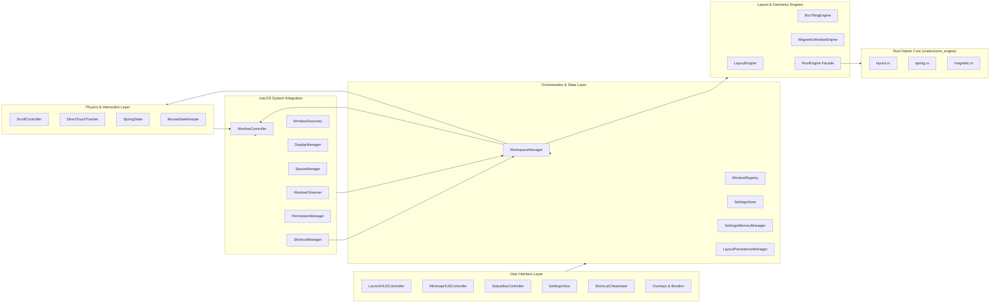

# Module 01: Executive Summary & Complete Codebase Inventory

## 1. Executive Summary & Design Paradigm

**Iume** is an ultra-fast, smooth, continuous horizontal sliding window manager engineered natively for macOS (macOS 14.0 Sonoma through macOS 26.x Sequoia/Tahoe). It ports and refines the continuous linear workspace paradigm popularized by Linux's **PaperWM** and **niri**, replacing traditional overlapping desktop clutter and rigid tiled grids with an infinite horizontal strip of window columns.

### Core Architectural Axioms
1. **Physical Desktop Coordinate Translation**: Because macOS does not expose a programmable compositor pipeline to third-party user-space applications (such as Wayland or X11), Iume translates an abstract infinite strip coordinate system onto physical desktop coordinates using macOS Accessibility APIs (`kAXPositionAttribute`, `kAXSizeAttribute`).
2. **Hybrid Rust/Swift Polyglot Engine**: Every performance-critical, allocation-sensitive calculation—including strip layout, viewport bounds projection, magnetic edge adhesion, and damped harmonic oscillator spring math—is implemented in pure, allocation-free standard-library Rust (`crates/iume_engine/`), linked via a static C ABI (`CIumeEngine`) into a Swift AppKit application.
3. **120 Hz Sub-Frame Smoothness**: Physical finger-touch trackpad events are resampled at native display refresh rates (60 Hz to 240 Hz ProMotion) using `CADisplayLink`. The motion engine provides direct 1:1 touch manipulation, exponential decay coasting, and aerodynamic drag across 4 selectable kinetic profiles (`.natural`, `.viscous`, `.highInertia`, `.snappy`).
4. **Resilient Window Server Pipeline**: Uses per-PID serial dispatch queues (`AppAXContext`) to isolate slow or unresponsive applications, bounded retries (capped at 3), latest-wins generation coalescing, feedback loop suppression, and app-quantized dimension tolerance (e.g., Terminal character cells).
5. **Zero Input Monitoring Requirement**: Global system-wide keyboard shortcuts are registered via Carbon `RegisterEventHotKey`, providing instant background interception without requiring invasive "Input Monitoring" permissions.

---

## 2. Directory Hierarchy

```
/Users/bves/projects/Iume/
├── .agentrules                           # AI agent governance rules protecting locked physics
├── .gitignore                            # Git exclusion rules (build artifacts, tokens, caches)
├── .scroll_lock.json                     # SHA-256 integrity hashes & PBKDF2 password manifest
├── CHANGELOG.md                          # Version release history and change tracking
├── INSTRUCTIONS.md                       # High-level developer guidance
├── IUME_COMPLETE_INVENTORY.md            # Structural file listing
├── LICENSE                               # MIT License
├── Package.swift                         # Swift Package Manager root configuration
├── README.md                             # Project overview and user documentation
├── SCROLL_LOCK_POLICY.md                 # Security documentation for locked scrolling engine
├── crates/
│   └── iume_engine/                      # Pure Rust layout & physics static library
│       ├── Cargo.lock
│       ├── Cargo.toml
│       └── src/
│           ├── ffi.rs                    # C ABI export layer and pointer validation
│           ├── layout.rs                 # Strip layout, centering, and column math
│           ├── lib.rs                    # Crate root, module exports, and ABI version
│           ├── magnetic.rs               # Magnetic edge attraction and seam ratio snapping
│           ├── spring.rs                 # Damped harmonic oscillator analytical physics solver
│           └── types.rs                  # C-compatible #[repr(C)] memory structs
├── dist/                                 # Build distribution outputs (.app, .zip, .dmg)
├── docs/                                 # Architecture, audit, and feature specifications
│   ├── ARCHITECTURE.md                   # System topology and component interactions
│   ├── COMPATIBILITY.md                  # Supported macOS versions and architectures
│   ├── FEASIBILITY_REPORT.md             # Technical feasibility study of macOS window management
│   ├── FEATURE_MAP.md                    # Implemented features and roadmap
│   ├── IUME_FIXES_AND_UPGRADES.md        # Bug fix history and architectural upgrades
│   ├── IUME_FIX_PARITY_UPGRADE_INSTRUCTIONS.md
│   ├── MARKETING_FEATURES.md             # End-user facing capability documentation
│   ├── PERMISSIONS.md                    # macOS TCC security and accessibility guide
│   ├── SHORTCUTS.md                      # Complete default keyboard shortcut reference
│   ├── TROUBLESHOOTING.md                # Diagnostic runbook for runtime issues
│   ├── audit/                            # Multi-phase audit reports, benchmarks, and logs
│   └── manual/                           # Deep-dive 10-module reverse-engineering specification
├── Resources/
│   ├── AppIcon.icns                      # High-resolution macOS application icon bundle
│   ├── Info.plist                        # Bundle properties, LSUIElement=1, bundle ID
│   └── Iume.entitlements                 # Hardened runtime entitlements (JIT, unsigned memory)
├── scripts/                              # Build, packaging, backup, and audit automation
│   ├── AppIconRenderer.swift             # Procedural AppIcon renderer
│   ├── build.sh                          # Debug compilation script
│   ├── build-release.sh                  # Release compilation script
│   ├── build-rust.sh                     # Cargo release staticlib compiler
│   ├── daily-backup.sh                   # Snapshot backup utility
│   ├── generate-appicon.sh               # Iconset generation tool
│   ├── package.sh                        # Production packager, codesigner, and DMG builder
│   └── audit/                            # Deterministic test harness scripts
│       ├── analyze.py                    # Benchmark log analyzer
│       ├── run-all-tests.sh              # Master test gate (413/413 checks)
│       ├── run-layout-tests.sh           # Layout verification suite (95 checks)
│       ├── run-physics-tests.sh          # Resampling & adversarial stress suite (238 checks)
│       ├── run-window-tests.sh           # AX pipeline & reliability suite (44 checks)
│       ├── scroll_bench.swift            # 120Hz synthetic scroll generator
│       ├── spring_bench.rs               # Rust spring performance benchmark
│       └── window_sampler.swift          # Live window server sampler
├── Sources/
│   ├── CIumeEngine/                      # C-bridge target exposing Rust ABI to Swift
│   │   ├── include/
│   │   │   └── iume_engine.h             # C header defining #[repr(C)] structs and functions
│   │   └── shim.c                        # C translation unit shim
│   ├── Iume/
│   │   └── main.swift                    # Application entry point, NSApplication, flock guard
│   ├── IumeCore/                         # Primary domain logic framework
│   │   ├── Controller/                   # Window movement, scrolling, and interaction
│   │   ├── Diagnostics/                  # Logging, signposts, and Mac setup verification
│   │   ├── Discovery/                    # Application and window discovery via NSWorkspace
│   │   ├── Display/                      # Multi-monitor geometry and hotplug monitoring
│   │   ├── Engine/                       # Swift facade for RustEngine FFI
│   │   ├── Interaction/                  # Mouse state keeper and drag/resize coordinator
│   │   ├── LayoutEngine/                 # Swift layout math, box tiling, and magnetic engine
│   │   ├── Models/                       # Core data models (Column, Window, Display, Presets)
│   │   ├── Observer/                     # AXObserver event tap and notification debouncer
│   │   ├── Permissions/                  # TCC Accessibility permission checker and prompt
│   │   ├── Persistence/                  # JSON disk persistence and memory snapshots
│   │   ├── Physics/                      # Damped spring oscillator state
│   │   ├── Registry/                     # Thread-safe in-memory window registry
│   │   ├── Settings/                     # SettingsStore backed by UserDefaults
│   │   ├── Shortcuts/                    # Carbon hotkey registration and key translations
│   │   ├── Space/                        # SkyLight private framework Mission Control monitor
│   │   ├── UI/                           # HUDs, Minimaps, SwiftUI Settings, Overlays, Sound
│   │   └── Workspace/                    # WorkspaceManager orchestrating entire lifecycle
│   └── IumeLiveTest/
│       └── main.swift                    # Live test runner executable
├── Tests/
│   └── IumeCoreTests/                    # Comprehensive XCTest suite (21 test fixtures)
└── tools/
    └── scroll_lock.py                    # SHA-256 & PBKDF2 cryptographic physics engine lock
```

---

## 3. Complete Source & Component Inventory

Below is the verified inventory of all source files comprising the project:

### 3.1 Rust Engine (`crates/iume_engine/`)
| Path | Lines | Role & Responsibilities |
| :--- | :---: | :--- |
| `crates/iume_engine/src/lib.rs` | 29 | Crate root; declares modules, exports public API, defines `VERSION`. |
| `crates/iume_engine/src/types.rs` | 260 | `#[repr(C)]` memory layout structs: `WindowId`, `Rect`, `EngineConfig`, `FrameOut`. |
| `crates/iume_engine/src/layout.rs` | 1,075 | Deterministic allocation-free column math, strip offsets, centering, and max offsets. |
| `crates/iume_engine/src/spring.rs` | 375 | Exact closed-form analytical solver for damped harmonic oscillator physics. |
| `crates/iume_engine/src/magnetic.rs` | 380 | Edge attraction, 32pt proximity detection, and seam ratio split calculations. |
| `crates/iume_engine/src/ffi.rs` | 440 | Safe C ABI entry points (`iume_compute_layout`, `iume_spring_step`, etc.). |

### 3.2 C Bridge (`Sources/CIumeEngine/`)
| Path | Lines | Role & Responsibilities |
| :--- | :---: | :--- |
| `Sources/CIumeEngine/include/iume_engine.h` | 192 | Clang module header declaring C signatures for Rust static library. |
| `Sources/CIumeEngine/shim.c` | 4 | Compilation unit ensuring Clang builds the `CIumeEngine` clang target. |

### 3.3 Swift Main & Core Subsystems (`Sources/IumeCore/`)
| Path | Lines | Subsystem & Key Responsibilities |
| :--- | :---: | :--- |
| `Sources/Iume/main.swift` | 98 | `NSApplication` entry, `flock` single-instance mutex, and signal traps. |
| `Sources/IumeCore/Controller/ScrollController.swift` | 2,311 | Viewport motion, `CADisplayLink`, direct touch resampling, 4 kinetic profiles. |
| `Sources/IumeCore/Controller/WindowController.swift` | 1,422 | Physical AX positioning, per-PID queues (`AppAXContext`), settle verification. |
| `Sources/IumeCore/Controller/FocusManager.swift` | 114 | Focus navigation (`⌥H/J/K/L`), cycling, and window activation. |
| `Sources/IumeCore/Controller/InteractionManager.swift` | 144 | Window drag/drop column reordering and footprint previews. |
| `Sources/IumeCore/Diagnostics/Diagnostics.swift` | 100 | Privacy-first structured in-memory logging buffer. |
| `Sources/IumeCore/Diagnostics/Signposts.swift` | 613 | `os_signpost` instrumentation for tracing layout and frame latency. |
| `Sources/IumeCore/Diagnostics/MacSetupChecker.swift` | 303 | Pre-flight diagnostic checking Displays Have Separate Spaces, TCC, and conflicts. |
| `Sources/IumeCore/Discovery/ApplicationDiscovery.swift` | 156 | Identifies active GUI applications via `NSWorkspace`, filtering daemons. |
| `Sources/IumeCore/Discovery/WindowDiscovery.swift` | 366 | Enumerates on-screen accessible windows via `CGWindowListCopyWindowInfo`. |
| `Sources/IumeCore/Display/DisplayManager.swift` | 79 | Monitors active physical displays, geometry, and hotplug reconfiguration. |
| `Sources/IumeCore/Engine/RustEngine.swift` | 599 | Swift facade marshalling Swift structs into flat buffers for `CIumeEngine`. |
| `Sources/IumeCore/Interaction/MouseStateKeeper.swift` | 173 | Amethyst-style mouse state coordinator mitigating AX drag race conditions. |
| `Sources/IumeCore/LayoutEngine/LayoutEngine.swift` | 1,574 | Reference pure-Swift strip layout engine, column resizing, and stacking. |
| `Sources/IumeCore/LayoutEngine/BoxTilingEngine.swift` | 1,433 | Multi-window adaptive grid tiling, halves/thirds/quarters, and BSP math. |
| `Sources/IumeCore/LayoutEngine/MagneticWindowEngine.swift` | 342 | Edge adhesion and magnetic guide calculation in Swift. |
| `Sources/IumeCore/Models/CoreModels.swift` | 844 | Core structs: `WindowColumn`, `DisplayGeometry`, `KineticScrollingProfile`. |
| `Sources/IumeCore/Models/ManagedWindow.swift` | 57 | Immutable window record tracking PID, AXUIElement, and cached attributes. |
| `Sources/IumeCore/Observer/WindowObserver.swift` | 249 | Subscribes to AX notifications (`kAXWindowCreatedNotification`, etc.). |
| `Sources/IumeCore/Permissions/PermissionManager.swift` | 161 | TCC Accessibility authorization checking and single-prompt policy. |
| `Sources/IumeCore/Persistence/LayoutPersistenceManager.swift` | 242 | Atomic JSON serialization of column layout state across reboots. |
| `Sources/IumeCore/Persistence/SettingsMemoryManager.swift` | 543 | Persistent file snapshot management for settings with crash recovery. |
| `Sources/IumeCore/Physics/SpringState.swift` | 136 | Pure Swift damped harmonic oscillator solver (mirrors Rust `spring.rs`). |
| `Sources/IumeCore/Registry/WindowRegistry.swift` | 149 | Thread-safe dictionary tracking all active `ManagedWindow` instances. |
| `Sources/IumeCore/Settings/SettingsStore.swift` | 1,085 | Central reactive configuration store backed by `UserDefaults`. |
| `Sources/IumeCore/Shortcuts/KeyTranslator.swift` | 47 | Converts human string shortcuts into Carbon virtual keycodes and modifiers. |
| `Sources/IumeCore/Shortcuts/ShortcutBinding.swift` | 459 | Codable shortcut definitions, conflict detection, and default chord maps. |
| `Sources/IumeCore/Shortcuts/ShortcutManager.swift` | 344 | Carbon `RegisterEventHotKey` global event dispatcher. |
| `Sources/IumeCore/Space/SpaceManager.swift` | 122 | Dynamic SkyLight private framework bridge for Mission Control Spaces. |
| `Sources/IumeCore/Workspace/WorkspaceManager.swift` | 3,953 | Central application orchestrator binding events, layout, motion, and windows. |
| `Sources/IumeCore/UI/LaunchHUDController.swift` | 685 | Kickstart HUD, Arrangement status, and live physics control panel. |
| `Sources/IumeCore/UI/MinimapHUDController.swift` | 1,264 | Minimap HUD orchestrator with 7 visual display modes. |
| `Sources/IumeCore/UI/MinimapHUDView.swift` | 134 | Circular dial canvas renderer with needle, ticks, and window pips. |
| `Sources/IumeCore/UI/MinimapLinearView.swift` | 185 | Horizontal linear strip minimap representation. |
| `Sources/IumeCore/UI/MinimapLoopCarouselView.swift` | 258 | 3D cylindrical loop carousel visualizer for circular mode. |
| `Sources/IumeCore/UI/MinimapHorizonEllipseView.swift` | 246 | Elliptical radar horizon minimap instrument. |
| `Sources/IumeCore/UI/MinimapTapeView.swift` | 237 | High-precision ticker-tape horizontal viewport minimap. |
| `Sources/IumeCore/UI/MinimapSpectrumView.swift` | 224 | Multi-color spectrum band minimap visualizer. |
| `Sources/IumeCore/UI/MinimapTimelineView.swift` | 224 | Temporal timeline minimap tracking recent window navigation. |
| `Sources/IumeCore/UI/MinimapEdgeRailView.swift` | 324 | Screen edge rail indicators showing parked off-screen windows. |
| `Sources/IumeCore/UI/SettingsView.swift` | 1,489 | Native SwiftUI 8-pane settings interface. |
| `Sources/IumeCore/UI/StatusBarController.swift` | 601 | Menu bar status item, dynamic layout switchers, and quick toggles. |
| `Sources/IumeCore/UI/StripOverviewController.swift` | 130 | Exposé-style strip overview window controller. |
| `Sources/IumeCore/UI/StripOverviewView.swift` | 179 | Interactive full-strip overview canvas with live window previews. |
| `Sources/IumeCore/UI/WindowPreviewCapturer.swift` | 103 | ScreenCaptureKit / CGWindowList thumbnail capture utility. |
| `Sources/IumeCore/UI/Overlays.swift` | 362 | Border overlays, magnetic snapping guidelines, and tab bar UI. |
| `Sources/IumeCore/UI/FocusBorderOverlay.swift` | 96 | High-contrast neon highlight border tracking focused window. |
| `Sources/IumeCore/UI/BoxPreviewHUDController.swift` | 129 | Semi-transparent preview footprint overlay for tiling operations. |
| `Sources/IumeCore/UI/RadialAndGridOverlays.swift` | 390 | Radial snap menu (⌃⌥B) and Custom Box Studio overlays. |
| `Sources/IumeCore/UI/ShortcutCheatsheetController.swift` | 215 | Interactive floating cheatsheet listing live shortcut bindings. |
| `Sources/IumeCore/UI/HudSoundEngine.swift` | 312 | Procedural audio engine generating haptic audio clicks and ticks. |
| `Sources/IumeCore/UI/MacSetupView.swift` | 89 | Diagnostic setup wizard assisting with permissions and OS settings. |
| `Sources/IumeCore/UI/WelcomeWindowController.swift` | 114 | First-run onboarding window and permission authorization flow. |

---

## 4. Subsystem Cross-Reference Map


