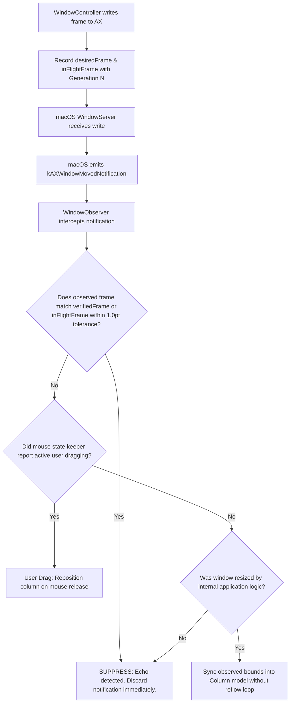

# Module 02: Architecture, Subsystems & Data Flows

## 1. System Architecture Overview

Iume operates as a resident background daemon on macOS (`LSUIElement = 1`). Because macOS Quartz WindowServer does not provide a programmable compositor windowing API to non-Apple processes, Iume functions by continuously observing window hierarchy events, calculating an ideal non-overlapping horizontal strip layout, and actively steering physical window positions using Accessibility C-APIs (`AXUIElementSetAttributeValue`).

```mermaid
sequenceDiagram
    autonumber
    actor User as User (Trackpad / Keyboard)
    participant Tap as CGEventTap / Carbon Hotkey
    participant Scroll as ScrollController (120Hz CADisplayLink)
    participant WS as WorkspaceManager
    participant Eng as RustEngine (iume_engine staticlib)
    participant WinCtrl as WindowController (AppAXContext Queues)
    participant AX as macOS WindowServer / AXUIElement

    User->>Tap: Trackpad Scroll / Shortcut Chord
    Tap->>Scroll: Raw Delta / Target Offset
    Note over Scroll: Resamples Touch & Integrates Spring State
    Scroll->>WS: publish(offset, velocity, interactive=true)
    WS->>Eng: iume_compute_layout(columns, config, offset)
    Eng-->>WS: IumeLayoutResult (CGRect[] frames, strip_width)
    WS->>WinCtrl: applyFrames(frames, isInteractive=true)
    Note over WinCtrl: Coalesces updates; isolates per-PID queue
    WinCtrl->>AX: AXUIElementSetAttributeValue(kAXPositionAttribute)
    AX-->>User: Physical Windows Glide Flawlessly on Screen
```

---

## 2. The Physical Desktop Coordinate Translation Model

### 2.1 Infinite Strip Coordinate Space
In Iume's model, the workspace is an infinite one-dimensional horizontal plane spanning from coordinate $X = 0$ to $X = \text{TotalStripWidth}$. Each window column $i$ is assigned a static strip anchor coordinate:

$$\text{StripX}_0 = 0$$
$$\text{StripX}_i = \text{StripX}_{i-1} + \text{Width}_{i-1} + \text{Gap}$$

Where:
- $\text{Width}_i$ is the physical pixel width allocated to Column $i$ (configured by ratio or preset).
- $\text{Gap}$ is the inter-column spacing in points (`SettingsStore.windowGap`).

### 2.2 Viewport Projection to Screen Space
The physical monitor screen represents a sliding camera aperture positioned at horizontal offset $\text{ViewportOffset}$. For any window $w$ belonging to column $i$, its screen-relative destination $X_{\text{screen}}$ is derived by projecting its strip coordinate against the display's visible work area:

$$X_{\text{screen}} = \text{VisibleFrame.origin.x} + \text{StripX}_i - \text{ViewportOffset}$$
$$Y_{\text{screen}} = \text{VisibleFrame.origin.y} + \text{TopMargin}$$
$$\text{Height}_{\text{screen}} = \text{VisibleFrame.size.height} - \text{TopMargin} - \text{BottomMargin}$$

### 2.3 Off-Screen Parking Mechanics
When $X_{\text{screen}} + \text{Width}_i < \text{VisibleFrame.origin.x}$ or $X_{\text{screen}} > \text{VisibleFrame.origin.x} + \text{VisibleFrame.size.width}$, the window is physically outside the monitor's display boundaries.
- **Negative Coordinate Parking**: macOS allows desktop windows to reside at negative coordinates (e.g., $X = -2400$) or far beyond display bounds.
- **`is_parked` Optimization**: When a window is parked off-screen, high-frequency updates are dropped. The window is assigned a stable parked anchor coordinate, and its Accessibility sizing attributes are preserved without incurring redundant IPC round-trips.

---

## 3. Concurrency & Threading Model

Iume strictly separates thread execution contexts to ensure that slow, blocked, or hung applications can never degrade user interaction or freeze the macOS trackpad event tap:

```
+---------------------------------------------------------------------------------------+
|                                    MAIN ACTOR THREAD                                  |
|   NSApplication RunLoop · CADisplayLink Tick (120 Hz) · ScrollController Physics      |
|   WorkspaceManager Orchestrator · SwiftUI HUD / Minimap Rendering                     |
+---------------------------------------------------------------------------------------+
        │                                                     ▲
        │ Dispatch In-Flight Frame                            │ Verification & Settle Callback
        ▼                                                     │
+---------------------------------------------------------------------------------------+
|                            APP AX SERIAL DISPATCH QUEUES                              |
|   com.iume.window-controller.ax.<PID> (QoS: UserInteractive)                          |
|   • Isolates every running application onto an independent serial queue.              |
|   • Slow Java, Electron, or Xcode processes never block Terminal or Finder updates.   |
|   • Latest-Wins Generation Coalescing drops stale intermediate 120Hz frames.          |
+---------------------------------------------------------------------------------------+
        │                                                     ▲
        │ AXUIElementSetAttributeValue                        │ AXObserver Event Notifications
        ▼                                                     │
+---------------------------------------------------------------------------------------+
|                                 macOS WINDOW SERVER                                   |
+---------------------------------------------------------------------------------------+
```

### Key Concurrency Rules:
1. **`@MainActor` Domain**: [`WorkspaceManager`](file:///Users/bves/projects/Iume/Sources/IumeCore/Workspace/WorkspaceManager.swift), [`ScrollController`](file:///Users/bves/projects/Iume/Sources/IumeCore/Controller/ScrollController.swift), [`FocusManager`](file:///Users/bves/projects/Iume/Sources/IumeCore/Controller/FocusManager.swift), and all UI Controllers run exclusively on `@MainActor`.
2. **Per-PID Queue Isolation ([`AppAXContext`](file:///Users/bves/projects/Iume/Sources/IumeCore/Controller/WindowController.swift#L92-L100))**: Each target application process has an isolated `DispatchQueue(label: "com.iume.window-controller.ax.\(pid)", qos: .userInteractive)`. If process A takes 80ms to respond to a resize event, process B and C continue receiving updates at 120Hz without delay.
3. **Rust Thread-Safety**: [`crates/iume_engine`](file:///Users/bves/projects/Iume/crates/iume_engine/) is completely stateless and re-entrant. Layout calculations borrow read-only slices and write into a thread-local fixed frame buffer, eliminating mutex contention and heap allocations.

---

## 4. Feedback Loop Suppression Architecture

A classic pathology in third-party window managers is the **Accessibility Echo Feedback Loop**:
1. Iume moves Window A to coordinate $(X=500, Y=25)$.
2. macOS WindowServer emits `kAXWindowMovedNotification` for Window A.
3. A naive window manager catches the notification, assumes the *user* dragged the window by hand, and triggers a full reflow.
4. The reflow causes another move, triggering another notification, resulting in an infinite CPU-pegging event storm.

### Iume's 5-Stage Feedback Defense:


1. **Generation Counter (`generation: UInt64`)**: Every layout request increments a 64-bit generation index. Responses arriving with stale generation numbers are discarded.
2. **Explicit Frame Ledger (`WindowFrameState`)**: Tracks `desiredFrame`, `inFlightFrame`, `verifiedFrame`, and `unverifiedObservedFrame`.
3. **Tolerance Matching (`frameMatches(a, b, tolerance: 1.0)`)**: Numerical floating-point discrepancies under 1 point are treated as exact matches.
4. **App-Quantized Dimension Awareness**: Recognizes that applications like Terminal constrain size to integer multiples of character cells, preventing fruitless repair cycles.
5. **Bounded Retry Cap**: Caps write failure retries at exactly 3 consecutive attempts. If an application refuses placement, it is quarantined rather than retried indefinitely.

---

## 5. End-to-End Component Interaction Matrix

| Subsystem | Receives Events From | Emits Events To | Primary Shared State |
| :--- | :--- | :--- | :--- |
| **`WorkspaceManager`** | App launch, Display change, Hotkey, Scroll | LayoutEngine, WindowController, Persistence | `workspaces: [CGDirectDisplayID: DisplayWorkspace]` |
| **`ScrollController`** | `CGEventTap` (trackpad), `CADisplayLink` | `WorkspaceManager.onScrollOffsetChanged` | `currentOffset`, `currentVelocity`, `springState` |
| **`LayoutEngine` / `RustEngine`**| Column dimensions, gap, viewport offset | Returns computed `CGRect` frames | None (pure functional calculation) |
| **`WindowController`** | Layout target frames | macOS Accessibility C-API | `_states: [WindowId: WindowFrameState]` |
| **`WindowObserver`** | `AXObserver` system notifications | `WorkspaceManager` window lifecycle hooks | Active observer handles |
| **`ApplicationDiscovery`** | `NSWorkspace.didLaunchApplicationNotification` | `WorkspaceManager.discoverAndRegisterWindows` | Running app cache |
| **`DisplayManager`** | `CGDisplayRegisterReconfigurationCallback` | `WorkspaceManager.handleDisplaysChanged` | `activeDisplays: [DisplayGeometry]` |
| **`SpaceManager`** | `NSWorkspace.activeSpaceDidChangeNotification` | `WorkspaceManager.handleSpaceChanged` | `currentSpaceId: UInt64` |
| **`SettingsStore`** | User interaction in Settings UI / Menu | Observers via Combine `@Published` | `UserDefaults` backing store |
| **`LayoutPersistenceManager`**| Timer debounce (3.0s) / Workspace change | Atomic write to `~/Library/Application Support/Iume/` | JSON file snapshots |
