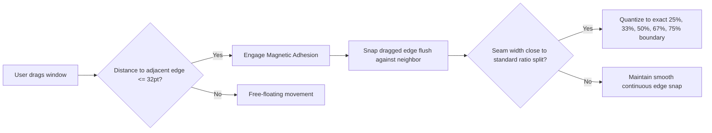

# Module 06: Layout Modes, Tab Grouping & Magnetic Snapping

## 1. Comprehensive Layout Modes

Iume provides multiple distinct layout algorithms governed by [`LayoutMode`](file:///Users/bves/projects/Iume/Sources/IumeCore/Models/CoreModels.swift#L685-L700) and [`BoxTilingEngine`](file:///Users/bves/projects/Iume/Sources/IumeCore/LayoutEngine/BoxTilingEngine.swift):

```
+─────────────────────────────────────────────────────────────────────────────────────────+
|                                    1. SCROLL STRIP (Continuous)                         |
|   [ Col 0: Terminal ]    [ Col 1: VS Code ]    [ Col 2: Safari ]    [ Col 3: Slack ]    |
|   Linear strip; viewport pans left/right with 120Hz spring physics.                     |
+─────────────────────────────────────────────────────────────────────────────────────────+

+─────────────────────────────────────────────────────────────────────────────────────────+
|                                    2. FOCUS COLUMN / CENTERED FOCUS                     |
|            [ Sliver L ]          |      CENTERED COLUMN      |          [ Sliver R ]    |
|   Focused column is locked to exact screen center; side columns peek at edges.          |
+─────────────────────────────────────────────────────────────────────────────────────────+

+─────────────────────────────────────────────────────────────────────────────────────────+
|                                    3. LOOP MODE (Endless Wrap Carousel)                 |
|   ... -> [ Col N ] -> [ Col 0 ] -> [ Col 1 ] -> [ Col 2 ] -> [ Col 0 ] -> ...           |
|   Circular strip; scrolling past the end wraps seamlessly around to the beginning.      |
+─────────────────────────────────────────────────────────────────────────────────────────+

+─────────────────────────────────────────────────────────────────────────────────────────+
|                                    4. BOX TILING (Adaptive Grids & BSP)                 |
|   +-----------------------+-----------------------+---------------------------------+   |
|   |                       |         Box 1         |              Box 3              |   |
|   |         Main          +-----------------------+---------------------------------+   |
|   |                       |         Box 2         |              Box 4              |   |
|   +-----------------------+-----------------------+---------------------------------+   |
+─────────────────────────────────────────────────────────────────────────────────────────+
```

### 1.1 Mode Detailed Mechanics:
1. **Scroll Strip (`.scrollStrip`)**: The default PaperWM/niri paradigm. Columns expand horizontally along an unbounded axis. Navigation smoothly translates the camera.
2. **Focus Column (`.focusColumn`)**: Minimal-scroll mode. The camera remains fixed unless the focused column moves off the edge of the visible screen.
3. **Centered Focus (`.centeredFocus`)**: The active column is strictly kept centered in the monitor's viewport.
4. **Manual / Free Layout (`.manual`)**: Disables automatic positioning; windows maintain the physical positions and sizes set by user dragging, without spring snap-back.
5. **Loop Mode (Circular Strip)**: When enabled (`SettingsStore.loopMode`), the strip wraps around end-to-beginning. Passing the rightmost column smoothly wraps to column 0, accompanied by a subtle acoustic wooden click feedback (`HudSoundEngine.playLoopTick`).

---

## 2. Column Stacks & Tabbed Window Groups

Columns in Iume are not restricted to single windows; multiple windows can be vertically stacked or tabbed within a single column:

### 2.1 Stacked Presentation (`.stacked`)
- Windows in the column divide the column's vertical height based on their individual `heightRatio`.
- **Keyboard Adjustments**:
  - `⌥+K / ⌥+J`: Focus up/down within the stack.
  - `Nudge Stack Taller / Shorter`: Expands or shrinks the focused window's vertical partition relative to its column neighbors.
  - `Equalize Stack Heights`: Distributes vertical space equally ($1/N$).

### 2.2 Tabbed Presentation (`.tabbed`)
- Windows in the column occupy 100% of the column's vertical height, stacked directly on top of each other.
- **Visual Tab Bar Overlay**: A sleek, dark translucent tab bar renders at the top of the column showing window icons, titles, and active tab highlights.
- **Tab Switching Transitions**:
  - **`Slide`**: The active window glides horizontally on an interactive spring (`TabMotion`).
  - **`Crossfade`**: The active tab dissolves gently from the old window to the new one.
- **Native Tab Grouping Detection**: When Safari, Finder, or Ghostty creates or switches internal tabs, Iume detects the native window change and reuses the column slot rather than spawning duplicate columns.

---

## 3. Magnetic Window Snapping & Edge Adhesion

The [`MagneticWindowEngine`](file:///Users/bves/projects/Iume/Sources/IumeCore/LayoutEngine/MagneticWindowEngine.swift) and Rust [`magnetic.rs`](file:///Users/bves/projects/Iume/crates/iume_engine/src/magnetic.rs) coordinate live window snapping during mouse dragging:



### 3.1 Mathematical Properties:
1. **Attraction Radius**: 32 points (`snapRadius = 32.0`). When a dragged edge approaches an adjacent column within 32 points, it magnetically jumps and adheres flush.
2. **Seam Ratio Snapping**: Boundaries snap to standard fractional proportions ($\frac{1}{4}, \frac{1}{3}, \frac{1}{2}, \frac{2}{3}, \frac{3}{4}$).
3. **Neighbor-Aware Resize**: Pulling the right edge of Column $A$ automatically pushes the left edge of Column $B$, maintaining a constant gap with zero overlap.
4. **Zero-Flicker Settle**: When dragging ceases, `MouseStateKeeper` enforces a 200ms hysteresis window to ensure Accessibility echo notifications do not cause the window to flicker back to its starting frame.

---

## 4. Multi-Display Geometry & Mission Control Spaces

Iume provides multi-display and multi-desktop isolation:

### 4.1 Independent Display Strips
- Every connected monitor (built-in Liquid Retina, external 4K/5K Studio Displays) maintains its own independent `DisplayWorkspace` instance.
- Scrolling the strip on Display 1 does not disturb the viewport offset of Display 2.
- **Display Hotplugging**: When an external monitor is unplugged, its windows are automatically migrated to the primary display with proportional width scaling.

### 4.2 Mission Control Virtual Spaces (Spaces 1–9)
- By querying macOS private SkyLight APIs (`CGSMainConnectionID`, `CGSGetActiveSpace`), Iume tracks virtual space transitions.
- Each virtual space maintains separate column ordering, ensuring that work projects on Space 1 never mix with communications on Space 2.
- **Space Throwing**: Dedicated hotkeys (`⌃⌥⇧⌘←` / `⌃⌥⇧⌘→`) move a window across macOS Mission Control spaces programmatically.
