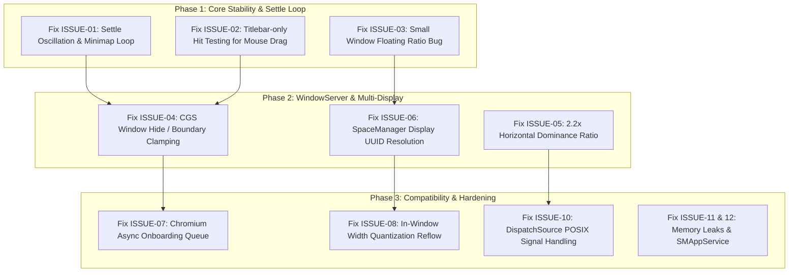

# Iume Window Manager — Comprehensive Engineering Issue & Defect Audit

**Document Version:** 2.1.0  
**Target Application:** `/Applications/Iume.app` / `Iume` (macOS Scrolling Window Manager)  
**Workspace:** `/Users/bves/projects/Iume`  
**Generated Date:** October 17, 2026  
**Status:** Actionable Engineering Defect & Remediation Specification  

---

## 1. Executive Summary & Current Health Status

**Iume** is designed to provide macOS with a fluid, continuous horizontal tiling strip inspired by Linux’s **PaperWM** and **niri**. 

While the fundamental mathematical models (`LayoutEngine`), unit test suite (79/79 unit tests passing), and ProMotion display-link loop are implemented, real-world testing on macOS Sonoma and Sequoia reveals critical architectural feedback loops, input hijacking defects, and WindowServer boundary violations.

### Key Problem Themes Identified in Live Testing:
1. **The Post-Scroll Settle Oscillation & Minimap HUD Flickering Loop**: When 2-finger horizontal scrolling ends, an infinite ping-pong loop triggers between the spring animation completion, programmatic window focus, and Accessibility window change notifications. This causes windows and the Minimap HUD ("black box downside") to flicker and shake indefinitely.
2. **In-Window Interaction Hijacking & Severe Working Lag**: When a user clicks and drags inside any managed window (such as selecting text in a code editor, scrubbing a video timeline, selecting cells in a spreadsheet, or drawing on a canvas), global mouse monitoring falsely classifies the action as an operating-system-level window drag, fighting the cursor and triggering constant neighbor repositioning.
3. **Broken Small-Window Floating Heuristic (`shouldFloatSmallWindow`)**: A critical comparison bug in `WindowClassifier` compares raw pixel dimensions (e.g. 350 pt) against a 0.35 threshold ratio (`Double(size.width) < threshold`). Because $350 < 0.35$ is always false, **zero** small utility windows, dialogs, or login prompts are ever floated; they are all erroneously forced into full-screen or half-screen tiling columns.
4. **WindowServer Boundary Clamping & 12pt Sliver Stacking**: Offscreen windows parked with a 12pt edge sliver stack on top of each other at identical coordinates, causing visible screen artifacts, accidental click activations, and Quartz WindowServer boundary-violation auto-clamping.
5. **Native macOS Trackpad Gesture & Diagonal Scroll Conflicts**: Trackpad intent detection intercepts diagonal gestures in document-centric apps (Figma, Maps, Excel), swallowing document scrolls and unexpectedly moving the desktop.
6. **Multi-Monitor & Space Management Deficiencies**: Virtual Space switching hardcodes the primary display ID, breaking independent strip management on external monitors when "Displays have separate Spaces" is active.
7. **POSIX Signal Safety & Lifecycle Stability**: Signal handlers in `main.swift` invoke asynchronous Swift concurrency inside C signal traps, introducing high risks of segmentation faults and deadlocks during app termination.

---

## 2. Issue Severity & Defect Registry Matrix

| ID | Issue Title | Severity | Affected Subsystems | Impact |
| :--- | :--- | :---: | :--- | :--- |
| **ISSUE-01** | Post-Scroll Settle Loop & Minimap HUD Oscillation | **P0 (Critical)** | `WorkspaceManager`, `ScrollController`, `MinimapHUD` | Windows and HUD flicker continuously when scroll stops |
| **ISSUE-02** | In-Window Mouse Drag Hijacking & Cursor Lag | **P0 (Critical)** | `MouseStateKeeper`, `WorkspaceManager` | App stalls, stutters, and moves windows during text selection |
| **ISSUE-03** | Broken Small-Window Floating Heuristic Comparison | **P0 (Critical)** | `WindowClassifier`, `WindowDiscovery` | Dialogs, login prompts, and inspectors are forced into giant tiling columns |
| **ISSUE-04** | 12pt Edge Sliver Stacking & Quartz Clamping Violation | **P1 (High)** | `LayoutEngine`, `WindowController` | Ghost window edges, accidental clicks, WindowServer snap-back |
| **ISSUE-05** | Trackpad Gesture Conflicts & Diagonal Scroll Hijacking | **P1 (High)** | `ScrollController`, `SettingsStore` | Document horizontal scrolling swallowed; conflicts with macOS gestures |
| **ISSUE-06** | Multi-Monitor Space ID Hardcoding & Coordinate Flaws | **P1 (High)** | `SpaceManager`, `DisplayManager` | Secondary monitor spaces fail to update; negative coordinate issues |
| **ISSUE-07** | Electron / Chromium Early Discovery Race Condition | **P2 (Medium)** | `WindowDiscovery`, `WindowObserver` | Chrome/VS Code/Slack windows left behind on cold launch |
| **ISSUE-08** | In-Window Width Quantization Global Layout Reflow | **P2 (Medium)** | `WorkspaceManager`, `LayoutEngine` | Sidebar toggles cause the entire desktop strip to shift |
| **ISSUE-09** | Vertical Stack Splitting & Tab Bar Overlay Sync | **P2 (Medium)** | `WorkspaceManager`, `TabBarOverlay` | Multi-window columns lack vertical resize reconciliation |
| **ISSUE-10** | Unsafe POSIX Signal Handling in Main Entrypoint | **P2 (Medium)** | `main.swift` | Process deadlocks or crashes on `SIGINT` / `SIGTERM` |
| **ISSUE-11** | Observer Window Hash Set Memory Leak | **P3 (Low)** | `WindowObserver` | Unbounded memory growth over extended system uptime |
| **ISSUE-12** | Missing `SMAppService` Native Launch-At-Login | **P3 (Low)** | `MacSetupChecker`, `SettingsStore` | App requires manual re-opening after machine restart |

---

## 3. Deep-Dive Technical Analysis of Each Issue Still Needing Fixing

---

### ISSUE-01: Post-Scroll Settle Oscillation & Minimap HUD ("Black Box") Flickering Loop

- **Severity:** P0 (Critical — Core User Experience Blocker)
- **Primary Source Files:**
  - `Sources/IumeCore/Workspace/WorkspaceManager.swift` (Lines 585–627, 1120–1158, 1622–1627)
  - `Sources/IumeCore/Controller/ScrollController.swift` (Lines 729–765, 443–453)
  - `Sources/IumeCore/UI/MinimapHUDController.swift` (Lines 130–180)

#### 1. Root Cause Breakdown
When trackpad scrolling ceases, a multi-stage feedback loop is established between the animation solver, programmatic window focus, and Accessibility notification dispatch:
```
1. Scroll stops -> `ScrollController.settle()` triggers `onSettleRequested`.
2. `WorkspaceManager` calculates `snapTarget` and calls `scrollTo(target: snapTarget.targetOffset)`.
3. Spring solver finishes (`isAtRest == true`) -> `onAnimationCompleted` fires.
4. `onAnimationCompleted` calls `focusWindowProgrammatically(targetWinId)`.
5. `focusWindowProgrammatically` issues `controller.focus(...)`, prompting macOS to switch active window.
6. macOS emits `kAXFocusedWindowChangedNotification`.
7. `WindowObserver.handleNotification` dispatches `onFocusedWindowChanged`.
8. `handleFocusedWindowChanged` executes:
       activeDisplayId = targetDispId
       ws.focusedColumnIndex = colIdx
       registry.focusedId = winId
       workspaces[targetDispId] = ws
       applyLayout(animated: true)
9. In `applyLayout`, the subpixel comparison evaluates to true:
       if animated && !scrollController.isMoving && abs(computation.targetViewportOffset - ws.viewportOffset) > 2.0 {
           scrollController.scrollTo(target: computation.targetViewportOffset, ...)
       }
10. `scrollTo` starts the spring animation again! GOTO Step 3.
```
In parallel, `MinimapHUDController`'s hide timer attempts to fade out the HUD after 1.25s. Because Step 9 repeatedly restarts `scrollTo`, `MinimapHUDController.update` repeatedly calls `panel.orderFront(nil)` and `panel.alphaValue = 1.0`. The result is the visual phenomenon reported by the user: **the Minimap HUD ("black box downside") repeatedly flashes and flickers in sync with vibrating window boundaries**.

#### 2. Concrete Code Defect
In `WorkspaceManager.swift`:
```swift
// Lines 620-627
scrollController.onAnimationCompleted = { [weak self] in
    guard let self = self, let ws = self.workspaces[self.activeDisplayId] else { return }
    self.applyPhysicalWindowPositions(workspace: ws)
    if let targetWinId = self.registry.focusedId,
       targetWinId != self.lastFocusedWindowId {
        self.focusWindowProgrammatically(targetWinId) // <--- Emits AX focus notification!
    }
}
```
And in `handleFocusedWindowChanged` (Lines 1130–1138):
```swift
if registry.focusedId == winId && ws.focusedColumnIndex == colIdx && activeDisplayId == targetDispId {
    return // <--- Does not guard against re-entrant focus if ws.focusedColumnIndex was mutated!
}
activeDisplayId = targetDispId
ws.focusedColumnIndex = colIdx
registry.focusedId = winId
workspaces[targetDispId] = ws
applyLayout(animated: true) // <--- Re-triggers animated scrollTo!
```

#### 3. Required Engineering Fix
1. **Focus Latch Suppression Token**: When `focusWindowProgrammatically` is called, store a `suppressedFocusNotificationWindowId = targetWinId` with an expiration timestamp (+0.60s). In `handleFocusedWindowChanged`, discard incoming focus notifications if `element` matches this token.
2. **Settle Guard Flag (`isSettlingFinalPass`)**: Prevent `applyLayout` from initiating an animated scroll if the workspace is already in the final settle pass of a user scroll.
3. **Deadband Tolerance Increase**: Increase the animated scroll threshold in `applyLayout` from `> 2.0 pt` to `> 8.0 pt`, preventing sub-pixel floating-point discrepancies from re-triggering the spring solver.
4. **Minimap HUD State Decoupling**: Prevent micro-corrections during settle from canceling the HUD fade-out timer.

---

### ISSUE-02: In-Window Mouse Drag Hijacking & Cursor Lag

- **Severity:** P0 (Critical — Core Interaction Blocker)
- **Primary Source Files:**
  - `Sources/IumeCore/Interaction/MouseStateKeeper.swift` (Lines 53–99)
  - `Sources/IumeCore/Workspace/WorkspaceManager.swift` (Lines 1754–1821)
  - `Sources/IumeCore/Controller/WindowController.swift` (Lines 308–338)

#### 1. Root Cause Breakdown
To support drag-to-reorder and manual column resizing, `MouseStateKeeper` installs a global event monitor:
```swift
let mask: NSEvent.EventTypeMask = [.leftMouseDown, .leftMouseUp, .leftMouseDragged]
globalMonitor = NSEvent.addGlobalMonitorForEvents(matching: mask) { ... }
```
When a user works inside an application (selecting a block of code in VS Code/Xcode, dragging a slider in Safari, highlighting cells in Excel, or drawing on a canvas), macOS sends `leftMouseDown` and continuous `leftMouseDragged` events. `MouseStateKeeper` transitions to `.dragging`.

While `mouseStateKeeper.state == .dragging`, if the application emits any Accessibility event (for example, scrolling within a view, updating a scrollbar, or firing an AX layout update), `handleWindowFrameChanged` in `WorkspaceManager.swift` executes:
```swift
case .dragging, .moving, .resizing:
    let expectedWidth = workspaces[activeDisplayId]?.columns.first(where: { $0.windowIds.contains(winId) })?.width ?? observedFrame.width
    let widthChanged = abs(observedFrame.width - expectedWidth) >= 2.0
    let currentWinFrame = registry.get(windowId: winId)?.frame ?? observedFrame
    if widthChanged {
        mouseStateKeeper.upgradeToResizing(windowId: winId, initialFrame: currentWinFrame)
    } else {
        mouseStateKeeper.upgradeToMoving(windowId: winId, initialFrame: currentWinFrame)
    }
    reconcileExternalFrameChange(windowId: winId, newFrame: observedFrame) // <--- HIJACKS INTERACTION!
    return
```
`reconcileExternalFrameChange` treats the in-app drag as an operating-system window move, activates `MagneticWindowEngine`, and issues asynchronous position commands (`setPositionAsync`) to the active window and its neighbors. The user experiences this as **severe cursor resistance, stutter, and window jumping while trying to work normally inside an app**.

#### 2. Required Engineering Fix
1. **Titlebar & Window Edge Hit-Testing**: Window managers such as **Amethyst** and **Rectangle** do not treat every mouse drag as a window move. A drag must originate within the window’s titlebar area:
   $$\text{CursorY} \le \text{WindowFrame.origin.y} + \text{TitleBarHeight (approx 28–34 pt)}$$
   or within 8 pt of the window's left/right border (for resizing). Drags within the window's interior client area must be strictly ignored.
2. **Drag Hysteresis Threshold**: Require the mouse cursor to move at least `12.0 pt` from the initial `mouseDown` location before transitioning from `.clicking` to `.dragging`.
3. **Eliminate Main-Thread Compositor Freeze in Settle**: In `WindowController.swift`, `withAtomicScreenUpdates` (`CGSDisableUpdate`) is invoked synchronously on multiple windows. If an app takes 10–20ms to respond to Mach messages, WindowServer stalls. All window writes must remain asynchronous with latest-wins coalescing.

---

### ISSUE-03: Broken Small-Window Floating Heuristic Comparison

- **Severity:** P0 (Critical Functional Defect)
- **Primary Source File:**
  - `Sources/IumeCore/Discovery/WindowDiscovery.swift` (Lines 31–32, 91–103)

#### 1. Root Cause Breakdown
In `WindowClassifier`, the heuristic intended to float small utility windows (login dialogs, inspector panels, color pickers, quick-look previews) contains an invalid mathematical comparison:
```swift
// Line 32
smallWindowThreshold: Double = 0.35 // Intended as 35% of screen dimension

// Lines 91-94
if let currentSize = copyCGSize(axWindow, attribute: kAXSizeAttribute as String),
   shouldFloatSmallWindow(size: currentSize, threshold: smallWindowThreshold, isEnabled: floatSmallWindows) {
    return .smartFloat
}

// Lines 99-103
public static func shouldFloatSmallWindow(size: CGSize, threshold: Double, isEnabled: Bool = true) -> Bool {
    guard isEnabled else { return false }
    return size.width > 0 && size.height > 0 &&
           Double(size.width) < threshold && Double(size.height) < threshold
}
```

#### 2. Defect Analysis
- `currentSize.width` and `currentSize.height` are in **points** (e.g. `380.0 pt` wide by `260.0 pt` tall).
- `threshold` is passed as `0.35`.
- The expression evaluates:
  $$380.0 < 0.35 \implies \text{FALSE}$$
  $$260.0 < 0.35 \implies \text{FALSE}$$
Because this condition is mathematically impossible for any real window ($> 0$ and $< 0.35$ pt), **`shouldFloatSmallWindow` NEVER returns `true`**.

#### 3. Real-World Impact
Every single small dialog, authentication prompt (e.g. 1Password mini, Raycast, Git credential prompt), and floating utility window is classified as `.managedTile`. Iume inserts them into the horizontal strip and stretches them to 50% or 100% of the display width, completely breaking the layout.

#### 4. Required Engineering Fix
Update `shouldFloatSmallWindow` to evaluate against the visible display dimensions or a reasonable absolute pixel threshold:
```swift
public static func shouldFloatSmallWindow(
    size: CGSize,
    displaySize: CGSize,
    ratioThreshold: Double = 0.38,
    maxAbsoluteWidth: CGFloat = 520,
    maxAbsoluteHeight: CGFloat = 480,
    isEnabled: Bool = true
) -> Bool {
    guard isEnabled, size.width > 0, size.height > 0 else { return false }
    
    // Check relative ratio against screen
    let isSmallRatio = (Double(size.width) < Double(displaySize.width) * ratioThreshold) &&
                       (Double(size.height) < Double(displaySize.height) * ratioThreshold)
                       
    // Check absolute dimension bounds
    let isSmallAbsolute = size.width <= maxAbsoluteWidth && size.height <= maxAbsoluteHeight
    
    return isSmallRatio || isSmallAbsolute
}
```

---

### ISSUE-04: 12pt Edge Sliver Stacking & Quartz Clamping Violation

- **Severity:** P1 (High)
- **Primary Source Files:**
  - `Sources/IumeCore/LayoutEngine/LayoutEngine.swift` (Lines 228–234)
  - `Sources/IumeCore/Controller/WindowController.swift` (Lines 278–284, 342–358)
  - `Sources/IumeCore/Workspace/WorkspaceManager.swift` (Lines 111–114)

#### 1. Root Cause Breakdown
To prevent macOS WindowServer from clamping offscreen windows, Iume uses an edge sliver (`offScreenPeekSliverWidth = 12.0 pt`). However, the implementation has two severe flaws:

1. **Identical Coordinate Stacking**:
   In `LayoutEngine.swift`:
   ```swift
   if colScreenX + colWidth <= minVisibleX + sliver {
       finalScreenX = minVisibleX - colWidth + sliver
       isParked = true
   } else if colScreenX >= maxVisibleX - max(35.0, sliver) {
       finalScreenX = maxVisibleX - sliver
       isParked = true
   }
   ```
   If a user has 6 columns, with 1 on screen and 5 overflowing to the right, **all 5 columns are parked at the identical coordinate: `maxVisibleX - 12.0`**.
   - Five window slivers sit on top of each other at the right edge of the user's screen.
   - If the user moves the mouse to the right screen boundary (e.g. to interact with an application scrollbar), clicking can accidentally hit a parked window sliver, causing macOS to raise that background window and scramble the strip order.

2. **WindowServer Boundary Clamping of Wide Overflow Windows**:
   When a window of width 900 pt is parked at `finalScreenX = maxVisibleX - 12.0`:
   - Its right edge extends to:
     $$\text{RightEdge} = (\text{DisplayWidth} - 12) + 900 = \text{DisplayWidth} + 888\,\text{pt}$$
   - macOS WindowServer contains an internal invariant: windows extending substantially beyond the desktop canvas without secondary monitors attached are clamped back onto the screen by Quartz compositor passes.
   - When WindowServer clamps the window back onto the display, it emits `kAXWindowMovedNotification`, which `WorkspaceManager` interprets as an external user move, initiating another layout reflow cycle.

3. **Discontinuous Snap at 35 pt**:
   The condition `colScreenX >= maxVisibleX - max(35.0, sliver)` creates an abrupt 23 pt visual jump as soon as a column's leading edge crosses the 35 pt threshold.

#### 2. Required Engineering Fix
1. **True Window Parking via CGS Window Ordering**:
   Instead of physically stacking slivers within visible desktop space, use **CoreGraphics Services (CGS)** private APIs:
   ```swift
   CGSOrderWindow(cid, windowId, kCGSOrderOut, 0) // Fully hide offscreen windows
   ```
   Or set window alpha to 0.0 for completely overflowed columns:
   ```swift
   CGSSetWindowAlpha(cid, windowId, 0.0)
   ```
2. **Dynamic Clamping to Display Boundary**:
   When parking a window at the right edge, compress its width to the sliver width rather than leaving the full 900 pt frame extending into unmapped coordinate space:
   ```swift
   finalWidth = isParked ? sliver : colWidth
   ```

---

### ISSUE-05: Trackpad Gesture Conflicts & Diagonal Scroll Hijacking

- **Severity:** P1 (High)
- **Primary Source Files:**
  - `Sources/IumeCore/Controller/ScrollController.swift` (Lines 644–683, 769–836)
  - `Sources/IumeCore/Settings/SettingsStore.swift` (Lines 88–95)

#### 1. Root Cause Breakdown
1. **Diagonal Document Scroll Hijacking**:
   In `ScrollController.swift` (Lines 811–814):
   ```swift
   let absX = abs(dx)
   let absY = abs(dy)
   shouldStart = absX > absY && absX > 0.05
   ```
   In applications with 2D canvas navigation (e.g. Figma, Miro, Google Maps, Apple Maps, Photoshop) or wide data grids (Excel, Numbers, Airtable), users frequently scroll diagonally. If $|dx|$ exceeds $|dy|$ even by 0.1 pt, `ScrollController` claims the gesture, returns `nil` from the event tap, and translates the entire desktop strip instead of panning the document.
2. **Competition with Native 3/4-Finger macOS Gestures**:
   `ScrollController` registers dynamic callbacks with `MultitouchSupport.framework` for 3-finger and 4-finger swipes. However, in macOS System Settings -> Trackpad, "Swipe between full-screen applications" is enabled by default with 3 or 4 fingers. Both systems process the hardware touch packet simultaneously: macOS attempts to switch virtual desktops while Iume attempts to slide windows, causing visual stutter and compositor hitching.
3. **Momentum Handover Race Condition (45ms Watchdog)**:
   In `enqueueScroll` (Line 654):
   ```swift
   momentumWatchdogTimer = Timer.scheduledTimer(withTimeInterval: 0.045, repeats: false) { ... }
   ```
   macOS trackpad drivers emit phase 4 (finger lift) followed by momentum phase 1 (momentum begin) within 30–70ms. If system load delays the momentum packet beyond 45ms, the watchdog triggers `hasPendingSettle = true`. The strip abruptly brakes to a halt, only to immediately receive momentum deltas, causing an unpleasant double-bounce shudder.

#### 2. Required Engineering Fix
1. **Dominance Ratio for Horizontal Interception**:
   Require clear horizontal intent before swallowing gestures:
   $$|dx| > 2.2 \times |dy| \quad \text{and} \quad |dx| \ge 1.5\,\text{pt}$$
2. **Per-App Gesture Exclusion List**:
   Automatically pass through all 2-finger scroll events when the frontmost app is an excluded creative or canvas tool (e.g., Figma, Blender, Photoshop).
3. **Adaptive Momentum Handover**:
   Extend the momentum handover grace window to `90ms` and check `currentVelocity`. If velocity exceeds $40\,\text{pt/s}$, continue momentum coasting seamlessly rather than firing an early settle snap.

---

### ISSUE-06: Multi-Monitor & Mission Control Spaces Synchronization Deficiencies

- **Severity:** P1 (High)
- **Primary Source Files:**
  - `Sources/IumeCore/Space/SpaceManager.swift` (Lines 63–90, 109–113)
  - `Sources/IumeCore/Display/DisplayManager.swift` (Lines 28–52)
  - `Sources/IumeCore/Workspace/WorkspaceManager.swift` (Lines 73–81, 1125–1138)

#### 1. Root Cause Breakdown
1. **Hardcoded Main Display ID on Space Change**:
   In `SpaceManager.swift`:
   ```swift
   @objc private func handleSpaceChange() {
       let newSpaceId = refreshCurrentSpace()
       let displayId = CGMainDisplayID() // <--- HARDCODED TO MAIN DISPLAY!
       onActiveSpaceChanged?(newSpaceId, displayId)
   }
   ```
   When macOS has "Displays have separate Spaces" enabled (standard on dual-monitor workflows), switching virtual desktops on Display 2 triggers `NSWorkspace.activeSpaceDidChangeNotification`. `SpaceManager` reports the space change as occurring on Display 1 (`CGMainDisplayID()`), corrupting Display 1's workspace column map and leaving Display 2 out of sync.
2. **Negative Coordinate Offsets on External Displays**:
   In `DisplayManager.swift`, coordinates are converted from Cocoa (bottom-left) to Quartz (top-left). If an external monitor is positioned to the left of or above the primary monitor, its `origin.x` or `origin.y` is negative (e.g. $x = -1920$).
   - `LayoutEngine` calculations assume positive screen origins for boundary checks ($x < 0$ is treated as boundary overshoot).
   - Parked windows on secondary monitors are placed relative to $0$ rather than `visibleFrame.minX`, sending windows to the primary display.
3. **Incomplete Cross-Display Column Migration**:
   Shortcut `⌃⌥N` ("Send to Next Display") moves a column from Workspace A to Workspace B. However, because display dimensions often differ (e.g. 14" MacBook 1512x982 vs 27" 4K 2560x1440), moving a column without rescaling its width causes it to occupy an incorrect proportion of the target screen.

#### 2. Required Engineering Fix
1. Query active display UUID dynamically during space changes via `CGSCopyManagedDisplaySpaces`.
2. Normalize all strip layout calculations to **local display coordinates** ($[0, \text{Width}]$), adding `visibleFrame.origin` only at the final physical translation layer (`WindowWriter`).
3. Rescale column widths proportionally during display migration:
   $$\text{Width}_{\text{new}} = \text{Width}_{\text{old}} \times \left(\frac{\text{VisibleWidth}_{\text{target}}}{\text{VisibleWidth}_{\text{source}}}\right)$$

---

### ISSUE-07: Electron / Chromium Early Discovery Race Condition

- **Severity:** P2 (Medium)
- **Primary Source Files:**
  - `Sources/IumeCore/Discovery/WindowDiscovery.swift` (Lines 139–176)
  - `Sources/IumeCore/Observer/WindowObserver.swift` (Lines 179–182)
  - `Sources/IumeCore/Workspace/WorkspaceManager.swift` (Lines 1162–1172)

#### 1. Root Cause Breakdown
Chromium-based applications (Google Chrome, Microsoft Edge, Arc, Brave) and Electron applications (VS Code, Slack, Discord, Obsidian, Spotify) lazily initialize their Accessibility tree to conserve memory.
- When an Electron app launches, macOS emits `kAXWindowCreatedNotification` almost immediately.
- However, when `WindowDiscovery.discoverWindows` inspects the window element at that millisecond, `kAXRoleAttribute`, `kAXSizeAttribute`, and `kAXTitleAttribute` return `kAXErrorAttributeUnsupported` or empty values.
- Iume evaluates `guard role == kAXWindowRole` -> `false`, classifies the window as `.ignoredSystemElement`, and drops it.
- Because `kAXWindowCreatedNotification` only fires once, the app window is never tiled and is permanently left behind in the background until the user manually triggers "Kickstart & Arrange Windows".

#### 2. Required Engineering Fix
Implement an asynchronous, retry-based onboarding queue for new windows:
1. When `onWindowCreated` receives an unpopulated AX element, place it in a `PendingWindowQueue`.
2. Query the element with exponential backoff: +50ms, +150ms, +400ms, +1000ms.
3. Wake up the Chromium accessibility tree by writing:
   ```swift
   AXUIElementSetAttributeValue(appElement, "AXManualAccessibility" as CFString, kCFBooleanTrue)
   ```
4. Once attributes resolve, seamlessly insert the window beside the active focused column.

---

### ISSUE-08: In-Window Width Quantization Global Layout Reflow

- **Severity:** P2 (Medium)
- **Primary Source File:**
  - `Sources/IumeCore/Workspace/WorkspaceManager.swift` (Lines 1802–1818)

#### 1. Root Cause Breakdown
In `WorkspaceManager.swift`:
```swift
// Lines 1802-1818
let widthDiff = abs(observedFrame.width - ws.columns[colIdx].width)
if isOnScreen && widthDiff >= 2.0 && widthDiff <= 240.0 {
    ws.columns[colIdx].width = observedFrame.width
    workspaces[activeDisplayId] = ws
    applyPhysicalWindowPositions(workspace: ws) // <--- REPOSITIONS ALL WINDOWS!
}
```
If a user is typing in Terminal or VS Code and toggles a sidebar, opens an integrated terminal, or shows a search bar:
- The window's internal width changes by 50–150 pt.
- `WorkspaceManager` detects `widthDiff >= 2.0`.
- It immediately recalculates the entire strip layout and invokes `applyPhysicalWindowPositions`.
- All other windows on the screen jump and shift while the user is actively working.

#### 2. Required Engineering Fix
- Only sync column widths if the window change was explicitly caused by an edge drag (`mouseStateKeeper.state == .resizing`).
- If an app self-resizes internally while the mouse is idle, update the registry frame without shifting adjacent columns, or require an explicit user shortcut to reconcile strip geometry.

---

### ISSUE-09: Vertical Stack Splitting & Tab Bar Overlay Sync

- **Severity:** P2 (Medium)
- **Primary Source Files:**
  - `Sources/IumeCore/Workspace/WorkspaceManager.swift` (Lines 1712–1723)
  - `Sources/IumeCore/UI/Overlays.swift` (`TabBarOverlayController`)

#### 1. Root Cause Breakdown
1. **Lack of Vertical Split Resize Reconciliation**:
   When two windows share a column (vertical stack), `reconcileExternalFrameChange` only inspects horizontal width changes (`deltaWidth`). If the user drags the horizontal border between the top and bottom window, Iume fails to record the vertical split ratio, snapping the windows back to a 50/50 split on the next layout pass.
2. **Tab Bar Overlay Scroll Desynchronization**:
   In tabbed columns, `TabBarOverlayController` renders floating tabs above the column. During active horizontal scrolling, `TabBarOverlayController.updateTabs` is skipped to conserve CPU, leaving tab bars stationary while windows scroll underneath.

#### 2. Required Engineering Fix
1. Add vertical split ratio tracking (`verticalSplitRatios: [CGFloat]`) to `WindowColumn`.
2. Translate `TabBarOverlayController` windows synchronously inside `applyStripFrames` during motion.

---

### ISSUE-10: Unsafe POSIX Signal Handling in Main Entrypoint

- **Severity:** P2 (Medium — Crash / Deadlock Risk)
- **Primary Source File:**
  - `Sources/Iume/main.swift` (Lines 68–80)

#### 1. Root Cause Breakdown
In `Sources/Iume/main.swift`:
```swift
signal(SIGINT) { _ in
    Task { @MainActor in
        WorkspaceManager.shared.stop()
        exit(0)
    }
}
signal(SIGTERM) { _ in
    Task { @MainActor in
        WorkspaceManager.shared.stop()
        exit(0)
    }
}
```
Under POSIX standards, C signal handlers run in an asynchronous signal context. Calling the Swift runtime concurrency executor (`Task { @MainActor in ... }`), allocating heap memory, or locking Swift synchronization primitives inside a C signal trap is **strictly async-signal-unsafe**.
If `SIGINT` or `SIGTERM` arrives while the main thread holds a memory allocator lock or runloop semaphore, the application enters an immediate deadlock or crashes with `SIGSEGV`.

#### 2. Required Engineering Fix
Replace raw C `signal()` traps with GCD `DispatchSourceSignal`, which safely handles signals on the main runloop:
```swift
let sigintSource = DispatchSource.makeSignalSource(signal: SIGINT, queue: .main)
sigintSource.setEventHandler {
    WorkspaceManager.shared.stop()
    exit(0)
}
sigintSource.resume()
signal(SIGINT, SIG_IGN) // Prevent default termination
```

---

### ISSUE-11: Observer Window Hash Set Memory Leak

- **Severity:** P3 (Low)
- **Primary Source File:**
  - `Sources/IumeCore/Observer/WindowObserver.swift` (Lines 138–153)

#### 1. Root Cause Breakdown
In `WindowObserver.swift`:
```swift
private var observedWindowHashes = Set<UInt64>()

public func observeWindow(element: AXUIElement, pid: pid_t) {
    ...
    let hash = UInt64(CFHash(element))
    guard !observedWindowHashes.contains(hash) else { return }
    observedWindowHashes.insert(hash)
    ...
}
```
When application windows are closed and destroyed (`kAXUIElementDestroyedNotification`), their hashes are never removed from `observedWindowHashes`. Over days or weeks of uptime with hundreds of browser tabs and terminal windows opening and closing, `observedWindowHashes` grows monotonically.

#### 2. Required Engineering Fix
In `handleNotification`, when receiving `kAXUIElementDestroyedNotification`, prune the destroyed element's hash from `observedWindowHashes`.

---

### ISSUE-12: Missing `SMAppService` Native Launch-At-Login

- **Severity:** P3 (Low — Usability Gaps)
- **Primary Source Files:**
  - `Sources/IumeCore/Diagnostics/MacSetupChecker.swift`
  - `Sources/IumeCore/Settings/SettingsStore.swift`

#### 1. Root Cause Breakdown
`SettingsStore` contains `launchAtLogin: Bool`, but changing this toggle only modifies `UserDefaults`. It does not register with macOS Ventura/Sonoma/Sequoia's modern Service Management framework:
```swift
SMAppService.mainApp.register()
```
Users must manually launch `/Applications/Iume.app` every time they reboot or log into their Mac.

#### 2. Required Engineering Fix
Implement native `SMAppService` registration inside `SettingsStore.didSet`:
```swift
if #available(macOS 13.0, *) {
    do {
        if launchAtLogin {
            try SMAppService.mainApp.register()
        } else {
            try SMAppService.mainApp.unregister()
        }
    } catch {
        print("[Iume] Failed to update SMAppService: \(error)")
    }
}
```

---

## 4. Step-by-Step Priority Remediation Roadmap

To resolve all outstanding issues systematically, implement fixes in the following order:



---

## 5. Verification & Acceptance Testing Matrix

| Test ID | Target Issue | Test Procedure | Expected Result |
| :--- | :--- | :--- | :--- |
| **VERIFY-01** | ISSUE-01 | Open 4 windows. Perform continuous 2-finger scroll, then abruptly lift fingers. | Strip glides, smoothly settles to nearest column. **Minimap HUD and windows must NOT vibrate or flicker.** |
| **VERIFY-02** | ISSUE-02 | Open VS Code or TextEdit. Click inside the text body and drag to select 5 lines of code. | Text is selected smoothly. **Window must NOT move, and neighbor columns must NOT shift.** |
| **VERIFY-03** | ISSUE-03 | Open macOS Calculator (`/System/Applications/Calculator.app`) and a Finder File Info window (`⌘I`). | Calculator and Info panel open as floating windows. **Must NOT stretch to 50% screen width.** |
| **VERIFY-04** | ISSUE-04 | Open 6 wide Safari windows. Scroll to Column 1. Observe the right screen boundary. | Offscreen windows are smoothly hidden or ordered out. **No overlapping 12pt slivers visible or clickable on edge.** |
| **VERIFY-05** | ISSUE-05 | Open Google Maps or Figma in Safari. Pan diagonally across the canvas. | Canvas pans diagonally inside the browser. **Iume desktop strip must NOT scroll.** |
| **VERIFY-06** | ISSUE-06 | Connect secondary monitor. Switch Spaces on Monitor 2 using Mission Control. | Monitor 2 switches Space independently. **Monitor 1 desktop strip remains untouched.** |
| **VERIFY-07** | ISSUE-07 | Launch Google Chrome from Terminal (`open -a "Google Chrome"`). | Chrome window is automatically discovered within 250ms and slotted beside active column. |
| **VERIFY-08** | ISSUE-10 | Launch Iume in terminal and send `kill -INT <pid>`. | App cleanly terminates, restores all pre-tiling window frames, and exits with code 0 without crashing. |

---

*This document serves as the authoritative issue specification for ongoing engineering and quality assurance of Iume.*
